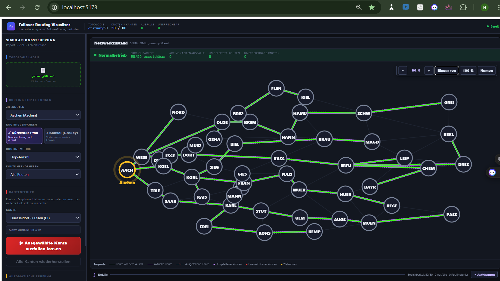
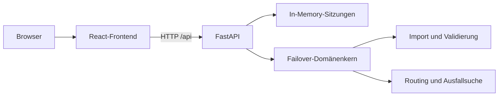

# Failover Routing Visualizer

Browserbasierter Prototyp zur interaktiven Untersuchung von
Failover-Routingzuständen. Die Anwendung entstand im Rahmen einer
Bachelorarbeit an der TU Dortmund und stellt eine deterministische
Kürzeste-Pfad-Strategie einem vorbereiteten lokalen Failover nach dem
Bonsai-Prinzip gegenüber.



## Welcher Stand liegt wo?

| Stand | Ort | Inhalt |
|---|---|---|
| Bachelorarbeit | Referenzzweige [`claude/referenz-bachelorarbeit-ed3b68c`](https://github.com/sammo3332/routing-simulator-hci-concept/tree/claude/referenz-bachelorarbeit-ed3b68c) und [`claude/referenz-vor-weiterentwicklung-99c2962`](https://github.com/sammo3332/routing-simulator-hci-concept/tree/claude/referenz-vor-weiterentwicklung-99c2962) | `ed3b68c` ist der technische Referenzstand der Arbeit, `99c2962` der letzte Stand vor der Weiterentwicklung |
| `main` | [`main`](https://github.com/sammo3332/routing-simulator-hci-concept/tree/main) (`ba4c99a`) | Stand `99c2962` und zusätzlich das Verschieben einzelner Knoten |
| Webanwendung | [routing-simulator-hci-concept.onrender.com](https://routing-simulator-hci-concept.onrender.com/), von Render aus `main` gebaut | Umfang von `main`: Knotenverschieben ja, die übrigen Neuerungen nicht (geprüft am 26. November 2026) |
| Weiterentwicklung | [`claude/paket-5-bildexport`](https://github.com/sammo3332/routing-simulator-hci-concept/tree/claude/paket-5-bildexport), Code-Stand `7cf4166` | alle unten genannten Neuerungen |

Bis auf das Knotenverschieben sind die Neuerungen noch nicht in `main`
übernommen und deshalb auch nicht online verfügbar. Ausprobieren lassen sie
sich lokal oder mit dem [Windows-Testpaket](#windows-testpaket).

## Funktionen

Grundfunktionen, auch in `main` und in der Webanwendung:

- Import von TopoHub-Node-Link-JSON, SNDlib-XML und einem begrenzten
  GraphML-Teilformat
- deterministische kürzeste Pfade mit Hop-Anzahl oder Kantengewicht
- Bonsai-Greedy mit vollständigen, bogendisjunkten Aboreszenzen
- manuelle, reversible Kantenausfälle und automatische Suche nach kritischen
  Ausfallkombinationen
- getrennte Erkennung physischer Trennung, Routing-Schleife und Sackgasse
- Vergleich von Ausgangs- und Fehlerzustand mit Pfaden, Statusangaben,
  Routentabelle und Ereignisprotokoll
- Zoom, Verschieben, automatisches Einpassen, Knotenkürzel und Hervorhebung
  einzelner Routen für größere Topologien

Nach der Bachelorarbeit hinzugekommen:

| Funktion | Was sie leistet | Enthalten in |
|---|---|---|
| Knoten verschieben | Einzelne Knoten lassen sich mit der Maus ziehen; „Knotenpositionen zurücksetzen“ stellt die berechnete Anordnung wieder her. | `main` und Webanwendung; auf dem Entwicklungszweig zusätzlich stabilisiert |
| Besser sichtbare graue Kanten | Kanten ohne Route sind deckend gezeichnet und in der Legende als „Kante ohne Route“ erklärt. | Entwicklungszweig |
| Szenarien speichern und laden | „Szenario speichern“ lädt Topologie, Zielknoten, Verfahren, Metrik und Ausfälle als JSON-Datei herunter. Die aktuelle Einstellung zur Namensanzeige und manuell verschobene Knotenpositionen werden ebenfalls mitgespeichert. „Szenario laden“ stellt diesen Zustand wieder her und berechnet alle Ergebnisse neu. | Entwicklungszweig |
| Windows-Programm | `FailoverRoutingVisualizer.exe` startet die vorhandene Oberfläche und den Python-Kern in einem eigenen Fenster. Python, Node.js und eine Internetverbindung sind nicht nötig. | Entwicklungszweig, [Testpaket](#windows-testpaket) |
| Graphexport als PNG und SVG | „PNG“ und „SVG“ in der Werkzeugleiste laden ein Bild der gesamten Topologie im aktuellen Zustand herunter, mit Kopfzeile und Legende und unabhängig vom Zoom. | Entwicklungszweig |

Die Anwendung entwickelt keine neue Routingheuristik. Sie verwendet bewusst
deterministische Referenzverfahren, um Zustandsänderungen reproduzierbar
darzustellen. Nicht Bestandteil des Prototyps sind unter anderem dauerhafte
Sitzungen, Mehrbenutzerbetrieb, Round-Robin-Verfahren und garantierte
Konvergenzzeiten. Auch eine gespeicherte Szenariodatei ist keine dauerhafte
Sitzung: Sitzungen liegen weiterhin nur im Arbeitsspeicher des Backends.

Die neuen Funktionen wurden nicht in einer Benutzerstudie untersucht. Die
Ergebnisse der Bachelorarbeit beziehen sich auf den damals evaluierten Stand.

## Architektur



Das Frontend stellt ausschließlich die vom Backend berechneten Zustände dar.
Parser, Validierung, Routing, Fehlerklassifikation und Szenarioserialisierung
liegen im UI-unabhängigen Python-Domänenkern. Das Windows-Programm startet
dieselbe FastAPI-Anwendung mit der gebauten Oberfläche auf `127.0.0.1` und
zeigt sie in einem eigenen Fenster. Der Bildexport entsteht vollständig im
Frontend aus der angezeigten Zeichnung und berechnet kein Routing. Eine
ausführliche Beschreibung steht in [ARCHITECTURE.md](ARCHITECTURE.md).

## Ausprobieren

### Lokal im Browser

Vorausgesetzt werden Python 3.12 sowie Node.js 22 oder eine kompatible Version.
Für die Neuerungen vorher den Entwicklungszweig auschecken:

```bash
git checkout claude/paket-5-bildexport
```

```bash
python -m venv .venv
source .venv/bin/activate
python -m pip install --require-hashes -r requirements-lock.txt
npm ci
```

Unter Windows wird die virtuelle Umgebung mit
`.venv\Scripts\activate` aktiviert. Anschließend werden API und Frontend in
zwei Terminals gestartet:

```bash
npm run dev:api
```

```bash
npm run dev
```

Das Frontend ist danach unter `http://127.0.0.1:5173` erreichbar. Vite leitet
Anfragen an `/api` an FastAPI auf Port 8000 weiter. Beispieltopologien liegen
in [`tests/fixtures/`](tests/fixtures/), etwa `bonsai_routing_failure.json` und
`synthetic_50_nodes.json`.

### Windows-Testpaket

Für Windows gibt es ein ungesigniertes Testpaket, kein Release:

- Programmdatei `FailoverRoutingVisualizer.exe` aus dem Workflow-Lauf
  [Windows-App Nr. 8](https://github.com/sammo3332/routing-simulator-hci-concept/actions/runs/45839046074)
  am Code-Stand `7cf4166`.
- Download als Artefakt
  [`FailoverRoutingVisualizer-windows`](https://github.com/sammo3332/routing-simulator-hci-concept/actions/runs/45839046074/artifacts/15126998436)
  (ZIP, rund 20 MB) auf der Seite des Laufs unter „Artifacts“. Dafür ist eine
  Anmeldung bei GitHub nötig. GitHub löscht das Artefakt am 24. Februar 2027.
- Nicht signiert: Beim ersten Start kann Windows SmartScreen warnen; über
  „Weitere Informationen“ → „Trotzdem ausführen“ startet das Programm. Es gibt
  kein Installationsprogramm.
- SHA-256 der Programmdatei:
  `3DF15124A54865705C50DFDE1FC9342F39BA7A70B78C0E367BE64E79F456BBD1`

Start, Voraussetzungen und Buildanleitung stehen in der
[Windows-Anleitung](docs/WINDOWS_APP.md).

### Container

```bash
docker build -t failover-routing-visualizer .
docker run --rm -p 8000:8000 failover-routing-visualizer
```

Oberfläche und Healthcheck liegen anschließend unter
`http://127.0.0.1:8000/` und `http://127.0.0.1:8000/api/health`.

## Prüfungen

```bash
npm run test:backend
npm run test:frontend
npm run lint
npm run build
```

Die Browserprüfungen brauchen die laufende Anwendung und eine lokale
Playwright-Installation mit Chromium:

```bash
node tests/browser/run-checks.cjs http://127.0.0.1:5173/
```

**Automatisierte Prüfungen.** Für den technischen Referenzstand
`ed3b68c36485f9a14062958832bc3fd9693e3975` wurden am 24. September 2026
insgesamt 52 bestandene Backend-, API- und Routingtests sowie 15 bestandene
Frontend-Logiktests dokumentiert. Auch das JavaScript-Linting und der
Vite-Produktions-Build waren erfolgreich. Die Bonsai-Implementierung wurde für
alle verbundenen einfachen Graphen mit bis zu fünf Knoten gegen ein
unabhängiges Kantenschnitt-Orakel geprüft. Details stehen in
[docs/BONSAI_VALIDATION.md](docs/BONSAI_VALIDATION.md).

Am Code-Stand `7cf4166` der Weiterentwicklung bestanden am 26. November 2026
128 Backend-Tests, 58 Frontend-Tests und 113 von 113 Browserprüfungen in
Chromium, dazu Linting und Build. Das Windows-Programm wurde im Lauf Nr. 8 auf
einem Windows-Runner von GitHub (Windows Server 2025) gebaut und im eigenen
Fenster geprüft: Dateiimport, Routing, Szenario speichern und laden, Bildexport,
auch bei per Firewall gesperrtem Internetzugang. Die vorhandene CI lief für die
Zweige der Weiterentwicklung nicht, weil kein Pull Request angelegt wurde.
Zuordnung aller Zahlen zu Commits und Skripten:
[Prüfbericht](docs/weiterentwicklung/PRUEFBERICHT.md).

**Manuelle Tests unter Windows.** Nach Angabe des Autors funktionierten am
26. November 2026 auf seinem eigenen Windows-Rechner Start, Szenariospeicherung
und Wiederherstellung nach einem Neustart, Laden und Neuberechnung ohne
Internet sowie das Speichern und Öffnen von SVG und PNG, auch ohne Internet.
Windows-Version und genaue Programmdatei sind nicht festgehalten; ein Protokoll
gibt es nicht.

**Weiterhin ungeprüft.** Nicht automatisiert geprüft sind der Windows-Dialog
„Speichern unter“ bis zur Datei auf dem Datenträger, Windows 10 und 11 auf
einem Arbeitsplatzrechner und ein Rechner ganz ohne Netzwerkverbindung. Gar
nicht geprüft sind andere Browser als Chromium und WebView2, eine Szenariodatei
auf einem zweiten Rechner und der Container-Build des Entwicklungszweigs.

Der Referenzstand der Arbeit ist kein Nachweis eines für alle Studienantworten
identischen Deployments. Die tatsächliche Erhebung und die späteren Änderungen
der Oberfläche sind im [Studienprotokoll](docs/hci/USER_STUDY_PROTOCOL.md) und
in der [HCI-Dokumentation](docs/hci/HCI_EVALUATION.md) getrennt beschrieben.

## Dokumentation

Stand der Bachelorarbeit:

| Dokument | Inhalt |
|---|---|
| [REQUIREMENTS.md](REQUIREMENTS.md) | implementierter und geprüfter Anforderungsumfang; Ergänzungen nach der Arbeit gesondert am Ende |
| [ARCHITECTURE.md](ARCHITECTURE.md) | Systemstruktur, Zustandsmodell und Datenfluss; Ergänzungen nach der Arbeit gesondert am Ende |
| [docs/BONSAI.md](docs/BONSAI.md) | projektspezifische Bonsai-Semantik und Grenzen |
| [docs/BONSAI_VALIDATION.md](docs/BONSAI_VALIDATION.md) | fachliche und automatisierte Validierung |
| [docs/DEPLOYMENT.md](docs/DEPLOYMENT.md) | gemeinsames Docker- und Render-Deployment |
| [docs/hci/HCI_EVALUATION.md](docs/hci/HCI_EVALUATION.md) | formative Entwicklung und Evaluationsdesign |
| [docs/hci/USER_STUDY_PROTOCOL.md](docs/hci/USER_STUDY_PROTOCOL.md) | Aufgaben, SUS und Auswertungsplan der Benutzerstudie |

Nach der Bachelorarbeit (nicht Teil des evaluierten Stands):

| Dokument | Inhalt |
|---|---|
| [docs/weiterentwicklung/UEBERSICHT_FUER_ERIK.md](docs/weiterentwicklung/UEBERSICHT_FUER_ERIK.md) | kurze Übersicht: was sich geändert hat und wie man es ausprobiert |
| [docs/WINDOWS_APP.md](docs/WINDOWS_APP.md) | Windows-Programm: Starten, Voraussetzungen, Build |
| [docs/DRAGGABLE_NODES.md](docs/DRAGGABLE_NODES.md) | Knoten manuell verschieben |
| [docs/weiterentwicklung/UEBERGABE.md](docs/weiterentwicklung/UEBERGABE.md) | Pakete, Zweige, Übernahme und offene Entscheidungen |
| [docs/weiterentwicklung/PRUEFBERICHT.md](docs/weiterentwicklung/PRUEFBERICHT.md) | technische Nachweise: Testzahlen je Commit, Windows-Läufe, unabhängige Prüfung |
| Paketdokumente [1](docs/weiterentwicklung/PAKET_1_KANTENLESBARKEIT.md), [2](docs/weiterentwicklung/PAKET_2_KNOTENVERSCHIEBEN.md), [3](docs/weiterentwicklung/PAKET_3_SZENARIEN.md), [4](docs/weiterentwicklung/PAKET_4_WINDOWS_APP.md), [5](docs/weiterentwicklung/PAKET_5_BILDEXPORT.md) | Einzelheiten, Vorher-/Nachher-Bilder und Grenzen je Neuerung |

## Reproduzierbarer Bonsai-Fehlerfall

1. `tests/fixtures/bonsai_routing_failure.json` importieren.
2. Zielknoten `T` und `Bonsai (Greedy)` auswählen.
3. In der automatischen Prüfung nach maximal einem Ausfall suchen.
4. Das Ergebnis in die Simulation übernehmen.

Der Fall zeigt einen weiterhin vorhandenen physischen Pfad von `A` nach `T`,
während die vorberechnete Bonsai-Strategie in eine Schleife gerät.
