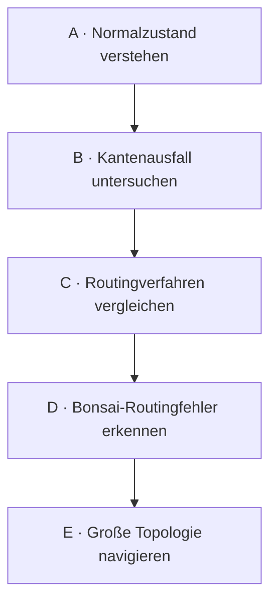

# Formative HCI-Evaluation des Failover Routing Visualizers

Aktualisiert: 14. Oktober 2026

## 1. Zweck und Status

Dieses Dokument beschreibt die Entwicklung der Oberfläche und fasst den
Stand der Benutzerstudie zusammen. Die Einschätzungen zu den Entwürfen
stammen aus der Entwicklung; eine unabhängige Expertenprüfung wurde damit
nicht durchgeführt. Die tatsächliche Erhebung und ihre methodischen Grenzen
sind im [Studienprotokoll](USER_STUDY_PROTOCOL.md) beschrieben.

## 2. Evaluationsfragen

Die folgenden Fragen dienten der Planung. Nicht alle wurden durch eigene
Messungen geprüft:

| ID | Frage |
|---|---|
| EF-1 | Verstehen Nutzende, welches Routingverfahren aktiv ist? |
| EF-2 | Können Nutzende einen Kantenausfall auslösen, seine Folgen erkennen und ihn rückgängig machen? |
| EF-3 | Können sie physische Trennung, Bonsai-Schleife und Sackgasse unterscheiden? |
| EF-4 | Bleibt die Topologie bei 15 und bei 50 Knoten übersichtlich und navigierbar? |
| EF-5 | Sind Ziel, aktuelle Route, Baseline, ausgefallene Kanten und Aboreszenz visuell unterscheidbar? |
| EF-6 | Unterstützt die Oberfläche eine Erklärung des Ergebnisses gegenüber Dritten? |

## 3. Entwicklung der Oberfläche

Die folgenden Screenshots zeigen frühe Entwicklungsstände. Sie dokumentieren
die Darstellung und den Funktionsumfang, keine gemessene Verbesserung der
Gebrauchstauglichkeit.

### 3.1 Ausgangszustand ohne Bonsai-Auswahl

Die erste Fassung konnte Topologien laden, Kanten deaktivieren und kürzeste
Pfade neu berechnen. Eine Auswahl zwischen Routingverfahren war noch nicht
vorhanden.

### 3.2 Auswahl des Routingverfahrens

Die Auswahl `Kürzester Pfad` und `Bonsai (Greedy)` wurde neben Ziel und
Routingmetrik angeordnet. Kurze Erläuterungen beschreiben die Neuberechnung
kürzester Pfade und das vorbereitete lokale Failover.

### 3.3 Bonsai und ausgewählte Arboreszenz

Im Bonsai-Modus zeigt die Oberfläche die Anzahl der Arboreszenzen, den
ausgewählten Baum mit gerichteten violetten Pfeilen, die Route und die
Anzahl der Baumwechsel. Physische Trennungen und Routingfehler werden getrennt
ausgewiesen. Der vollständige schrittweise Routing-Trace liegt im Backend vor,
wird aber nicht als eigene Detailansicht im Frontend angezeigt.

### 3.4 Erste Darstellung von Germany50

Der Graph nutzte nur einen kleinen Teil der Zeichenfläche. Lange Ortsnamen
überlagerten sich. Auch bei eingeklappten Details blieb viel Fläche ungenutzt.

### 3.5 Automatisches Einpassen

Das automatische Einpassen vergrößerte den Graphen. Gleichzeitig wurden lange
Namen ausgeblendet. Dadurch fehlte vielen Knoten in der Übersicht eine
sichtbare Bezeichnung.

### 3.6 Eindeutige Knotenkürzel

Die nächste Fassung ergänzte eindeutige Knotenkürzel und Tooltips mit dem
vollständigen Namen. Ziel-, Fehler-, Umleitungs- und ausgewählte Startknoten
bleiben beschriftet. Eine einzelne Route kann hervorgehoben werden.

### 3.7 Vollständige Knotennamen

Über `Namen` lassen sich die vollständigen Bezeichnungen einblenden.
In dichten Bereichen können sie sich überlagern. Die Standardansicht
verwendet deshalb Kürzel und Tooltips.

## 4. HCI-Prinzipien und Umsetzung

| Prinzip | Umsetzung und Grenze |
|---|---|
| Sichtbarkeit des Systemzustands | Statusanzeige, Kennzahlen, Graph, Routentabelle und Ereignisprotokoll geben den aktuellen Zustand wieder. |
| Fachliche Bezeichnungen | Ziel, Kanten, Routen, Bäume und Fehlerarten werden in der Oberfläche benannt. |
| Kontrolle und Reversibilität | Einzelne oder alle ausgefallenen Kanten können wiederhergestellt werden. |
| Konsistenz | Graph, Legende und Ergebnistabelle verwenden gemeinsame Farben und Statusbegriffe. |
| Auswahl und Ausfallaktion | Neben dem direkten Kantenklick stehen eine Kantenauswahl und eine separate Ausfallaktion zur Verfügung. |
| Wiedererkennen | Verfahrensauswahl, Legende, Kürzel und Tooltips erläutern die dargestellten Elemente. |
| Navigation | Einpassen, Zoom, Verschieben, einklappbare Details und die Hervorhebung einzelner Routen unterstützen die Untersuchung. |
| Informationsumfang | Die Standardansicht verwendet Kürzel. Vollständige Namen können sich bei großen Graphen überlagern. |
| Fehlerdiagnose | Physische Trennung, Schleife und Sackgasse werden getrennt ausgegeben. Der vollständige Routing-Trace fehlt in der Oberfläche. |
| Dokumentation | README und Bonsai-Dokumentation beschreiben Bedienung, Berechnung und Grenzen. |

## 5. Nutzungsszenarien für die Evaluation

Die Reihenfolge führt vom einfachen Ablesen des Systemzustands über eine
reversible Störung bis zur fachlich anspruchsvollen Fehlerdiagnose und zur
Navigation einer großen Topologie.

### Szenario A: Normalzustand verstehen

**Ausgangslage:** `atlanta.xml`, keine Ausfälle, kürzester Pfad.

**Aufgabe:** Ziel `N1` wählen und erklären, wie viele Knoten das Ziel erreichen
und welche Farbe die aktuelle Route besitzt.

**Erfolg:** Die Person nennt Ziel, Erreichbarkeit und aktuelle Route korrekt,
ohne Unterstützung durch die Testleitung.

### Szenario B: Manuellen Kantenausfall untersuchen

**Ausgangslage:** Atlanta, kürzester Pfad.

**Aufgabe:** Eine Kante im Graphen ausfallen lassen, die Folgen erklären und die
Kante anschließend wiederherstellen.

**Erfolg:** Ausfall und Reparatur gelingen; die Person erkennt umgeleitete oder
unerreichbare Knoten und kann die Statusänderung erklären.

### Szenario C: Routingverfahren vergleichen

**Ausgangslage:** Atlanta ohne Ausfall.

**Aufgabe:** Von `Kürzester Pfad` zu `Bonsai (Greedy)` wechseln, eine
Aboreszenz auswählen und den Unterschied der Verfahren mit eigenen Worten
erklären.

**Erfolg:** Die Person unterscheidet Neuberechnung nach Ausfall von vorbereitetem
lokalem Failover und erkennt die gerichteten Baumkanten.

### Szenario D: Routingfehler trotz physischer Verbindung

**Ausgangslage:** `tests/fixtures/bonsai_routing_failure.json`, Ziel `T`, Bonsai.

**Aufgabe:** Mit der automatischen Prüfung einen kritischen Einzelausfall finden,
ihn übernehmen und beurteilen, ob eine physische Trennung oder ein Routingfehler
vorliegt.

**Erfolg:** Die Person identifiziert die Schleife als Routingfehler bei weiterhin
vorhandenem physischem Weg.

### Szenario E: Große Topologie navigieren

**Ausgangslage:** `germany50.xml`.

**Aufgabe:** Ziel `Aachen` wählen, die Topologie einpassen, einen unbekannten
Knoten per Tooltip identifizieren, eine einzelne Startknotenroute hervorheben und
bei Bedarf alle Namen einblenden.

**Erfolg:** Die Person findet und erklärt alle Funktionen, ohne die Orientierung
im Graphen zu verlieren.

## 6. Benutzerstudie

Aus LimeSurvey 736933 wurden 11 Fragebögen ausgewertet. Die abgeschlossenen
Antworten stammen vom 20. September bis 4. Oktober 2026. Erhoben wurden
Vorkenntnisse, selbst berichtete Aufgabenbearbeitung, zehn SUS-Antworten,
vier geschlossene Rückfragen und ein optionales Freitextfeld.

Der SUS-Mittelwert beträgt 67,7, der Median 72,5 und die Spannweite 30 bis 90.
Kapitel 6 der Bachelorarbeit enthält die Auswertung. Das
[Studienprotokoll](USER_STUDY_PROTOCOL.md) beschreibt die Durchführung,
nicht erhobene Messgrößen und die Grenzen der Versionszuordnung.

## 7. Screenshots

Das [Screenshot-Register](SCREENSHOT_REGISTER.md) nennt die vorhandenen Bilder,
ihre Herkunft und den dargestellten Entwicklungsstand.

## 8. Aktueller Evaluationsstand

Der technische Funktionsumfang wurde mit dem Betreuer abgestimmt. GraphML wurde
am 15. September 2026 einschließlich Parser, API, Upload und Tests ergänzt. Der
vollständige schrittweise Bonsai-Trace, Round-Robin, RR-Swapping und weitere
Routingverfahren gehören nicht zum untersuchten Umfang.

Die Benutzerstudie ist in Kapitel 6 der Bachelorarbeit ausgewertet.
Nach Abschluss der Erhebung wurden die Option `Keine Route hervorheben`,
die Bezeichnung `Physisch getrennte Knoten` bei der Graphansicht und die
zunächst eingeklappten Ergebnisdetails ergänzt. Die untere Kennzahl
`Physisch getrennt` bestand bereits im technischen Referenzstand.
Diese späteren Änderungen wurden nicht erneut durch eine Benutzerstudie bewertet.

## 9. Technische Prüfung

Automatisierte Tests prüfen Import, Routing, Fehlerklassifikation und
Ausfallsuche. Umfang und Ergebnisse stehen in der
[Bonsai-Validierung](../BONSAI_VALIDATION.md) und in
[REQUIREMENTS.md](../../REQUIREMENTS.md). Die
[Architekturbeschreibung](../../ARCHITECTURE.md) erläutert die Komponenten
und den Datenfluss.
