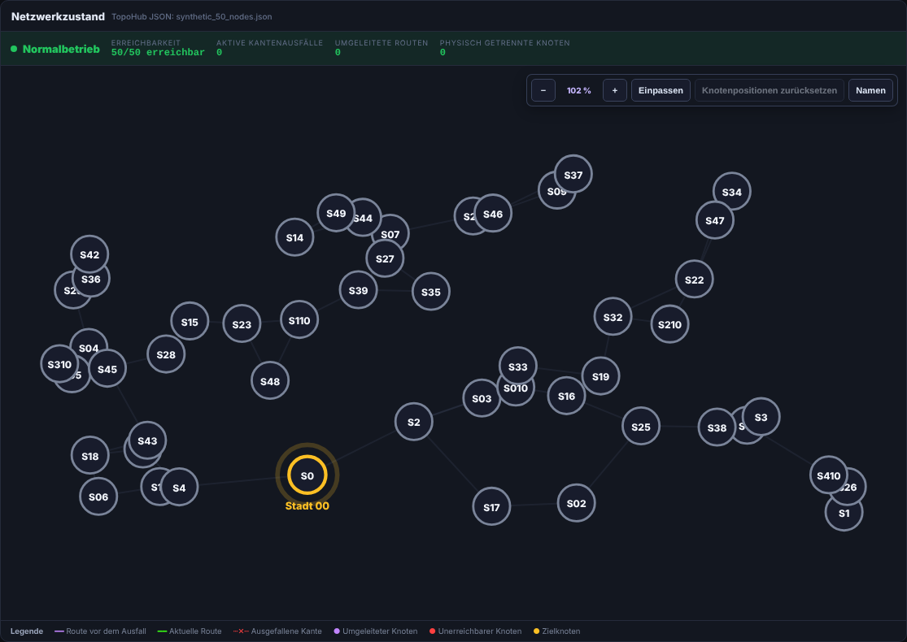
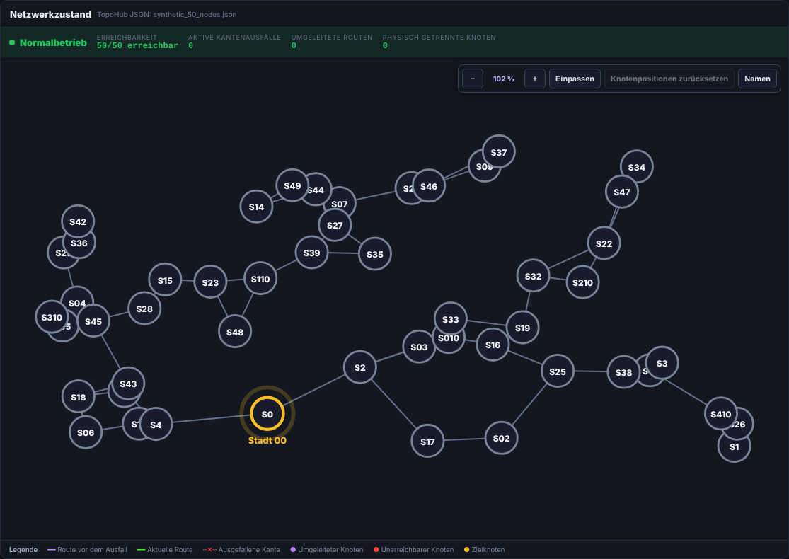
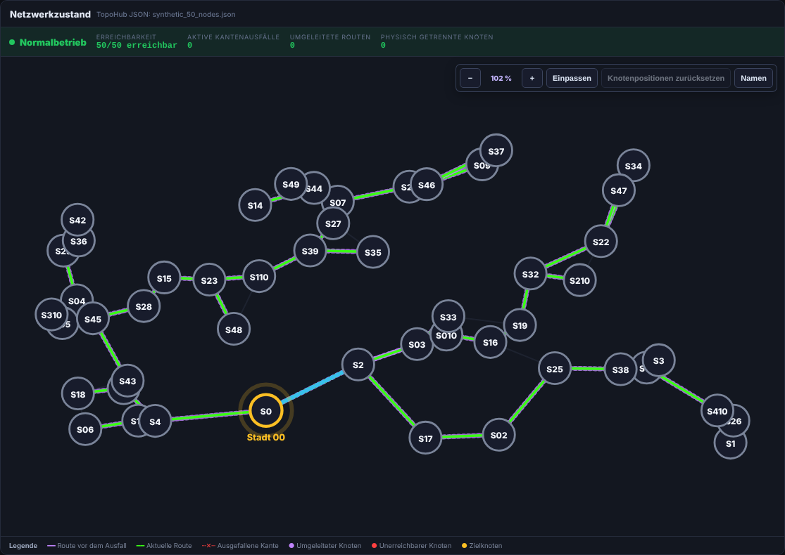
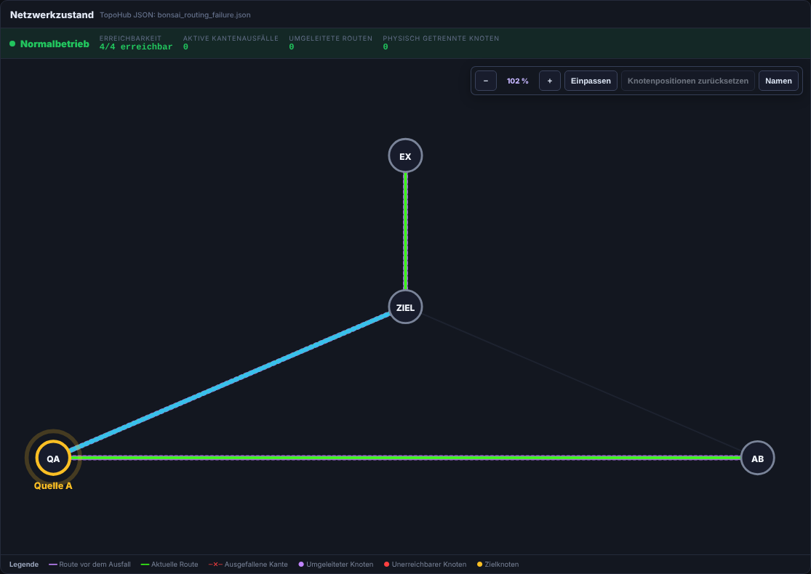
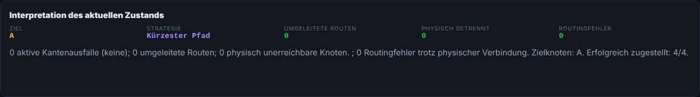
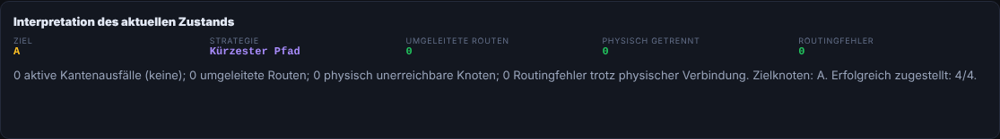

# Änderungsprotokoll der Weiterentwicklung

Stand: 25. November 2026

Dieses Protokoll dokumentiert Änderungen nach der Bachelorarbeit. Es gehört
nicht zum evaluierten Stand. Jede sichtbare Änderung wird mit Problem,
Begründung, Vorher-/Nachher-Vergleich und Prüfung beschrieben.

Die Einträge belegen, **dass ein beschriebenes Problem im Test nicht mehr
auftritt**. Sie belegen keine verbesserte Gebrauchstauglichkeit. Dafür wäre
eine erneute Prüfung mit Nutzenden nötig; sie hat nicht stattgefunden.

## 1. Referenzstände

| Bezeichnung | Commit | Quelle der Zuordnung | Lokaler Tag |
|---|---|---|---|
| Technischer Referenzstand der Arbeit | `ed3b68c36485f9a14062958832bc3fd9693e3975` | `README.md`, `docs/hci/USER_STUDY_PROTOCOL.md` | `bachelorarbeit-referenzstand` |
| Letzter Stand vor der Weiterentwicklung | `99c2962962cc706f88a38af34254a180003d55ab` | `docs/DRAGGABLE_NODES.md` | `stand-vor-weiterentwicklung` |
| Ausgangspunkt dieses Protokolls („Vorher“) | `ba4c99ae7fc0209bfe7eb12aa0cca3956cab8790` | Stand von `main` am 25. November 2026 | – |

Beide Referenz-Commits liegen in der Historie von `main` und sind dadurch auf
GitHub vorhanden. Die zwei Tags wurden lokal angelegt; das Hochladen wurde vom
Server mit HTTP 403 abgelehnt. **Die Tags sind daher noch nicht auf GitHub
gesichert.** Sie lassen sich mit Schreibrechten so nachtragen:

```bash
git tag -a bachelorarbeit-referenzstand ed3b68c36485f9a14062958832bc3fd9693e3975 -m "Technischer Referenzstand der Bachelorarbeit"
```

```bash
git tag -a stand-vor-weiterentwicklung 99c2962962cc706f88a38af34254a180003d55ab -m "Letzter Stand vor der Weiterentwicklung"
```

```bash
git push origin bachelorarbeit-referenzstand stand-vor-weiterentwicklung
```

Welcher der beiden Commits dem abgegebenen Stand der Arbeit entspricht, geht
aus dem Repository nicht eindeutig hervor. Deshalb sind beide markiert.

Die Weiterentwicklung findet im Zweig `claude/gallant-fermat-h4hdmg` statt.
`main` und das Deployment bleiben unverändert.

## 2. Leitlinien

- Layout, Navigation, Begriffe, Farbbedeutungen und Bedienabläufe bleiben.
- Benötigte Funktionen verwenden bestehende Komponenten und Stilwerte.
- Es wird kein neuer Schaltflächenstil eingeführt.
- Keine Funktion wird wegen ihres Aussehens entfernt.
- Vorrang haben Fehlerbehebung und zuverlässiger Betrieb.

Zum blau-violetten Buttonstil: Im Code dieses Zweigs gibt es keinen neu
eingeführten Schaltflächenstil. Die Schaltfläche „Knotenpositionen
zurücksetzen“ aus `ba4c99a` verwendet denselben `buttonStyle` wie „Einpassen“.
Violett erscheint nur an Stellen, die bereits in den Screenshots S-02 und S-06
des [Screenshot-Registers](../hci/SCREENSHOT_REGISTER.md) sichtbar sind:
gewähltes Routingverfahren, aktive Option „Namen“ und Logo. Daran wurde nichts
geändert.

## 3. Prüfumgebung

| Feld | Wert |
|---|---|
| Datum | 2026-11-25 |
| Browser | Chromium 158.0.8127.36, headless, über Playwright |
| Fenstergröße | 1440 × 900 CSS-Pixel, Skalierung 1 |
| Betriebssystem | Linux (Container) |
| Topologien | `tests/fixtures/bonsai_routing_failure.json`, `tests/fixtures/topohub_mini.json`, `tests/fixtures/synthetic_50_nodes.json` |
| Prüfskript | `tests/browser/interaction-checks.cjs` |

`synthetic_50_nodes.json` ist eine künstlich erzeugte Topologie mit 50 Knoten
und 65 Kanten. Sie ersetzt für diese Prüfung `germany50.xml`, das nicht im
Repository liegt. Sie ist keine reale Netztopologie.

Die Screenshots zeigen jeweils den Bereich „Netzwerkzustand“ ohne
Nachbearbeitung. Sie sind Arbeitsnachweise dieser Weiterentwicklung und keine
finalen Abbildungen im Sinne des Screenshot-Registers.

Nicht geprüft wurden: andere Browser, Touch-Bedienung, Bildschirmleser, echte
Nutzung durch Personen sowie die Topologien Atlanta und Germany50.

## 4. Sichtbare Änderungen

### Ä-01 Sichtbarkeit der Kanten ohne Route

**Problem.** Kanten, die auf keiner Route liegen, wurden mit `#31394d` und
35 % Deckkraft auf dem Flächenhintergrund `#131720` gezeichnet. Das ergibt
rechnerisch einen Kontrast von 1,14:1. Mit „Keine Route hervorheben“ sind
alle Kanten betroffen; die Verbindungen der Topologie sind dann kaum zu
erkennen. Im Normalfall betrifft es die Kanten, die als Ausweichwege für einen
Ausfall in Frage kommen.

**Begründung.** Eine Kante ist Information, die zum Verstehen des Graphen
nötig ist, und zugleich das Klickziel für einen Kantenausfall. Als Richtwert
dient die Mindestanforderung 3:1 für grafische Objekte aus WCAG 2.1,
Erfolgskriterium 1.4.11.

**Änderung.** Die Kanten verwenden den bereits in der Oberfläche vorhandenen
Grauton `#64708a` (bisher für Beschriftungen genutzt) und werden deckend
gezeichnet. Strichstärke, Form und alle übrigen Farben bleiben gleich. Die
Farbbedeutung „grau = Kante ohne Route“ bleibt bestehen.

| | Vorher | Nachher |
|---|---|---|
| Farbe / Deckkraft | `#31394d` / 0,35 | `#64708a` / 1 |
| Kontrast zum Hintergrund | 1,14:1 | 3,61:1 |
| Kontrast der übrigen Kantenfarben | Grün 13,23:1 · Violett 6,79:1 · Rot 5,17:1 | unverändert |

Große Topologie mit „Keine Route hervorheben“:

| Vorher | Nachher |
|---|---|
|  |  |

Große Topologie mit „Alle Routen“:

| Vorher | Nachher |
|---|---|
|  |  |

Kleine Topologie im Normalbetrieb:

| Vorher | Nachher |
|---|---|
|  |  |

**Prüfung.**

- Browser: Farbe und Deckkraft der gezeichneten Linie ausgelesen und der
  Kontrast berechnet (Prüfung K-1). Vorher 1,14:1, nachher 3,61:1.
- Automatischer Test `tests/frontend/edgeContrast.test.js`: mindestens 3:1,
  und Routen- sowie Ausfallfarben bleiben kontraststärker als Grau.
- Sichtvergleich der Screenshots.

**Nicht belegt.** Ob Nutzende Kanten jetzt schneller finden oder Aufgaben
besser lösen. Offen ist auch, ob die deutlicheren grauen Kanten bei dichten
Graphen mit vielen Routen die Darstellung unruhiger machen. Im Screenshot der
synthetischen Topologie bleiben die Routen klar dominant; für Germany50 mit
88 Kanten wurde das nicht geprüft.

### Ä-02 Text „Interpretation des aktuellen Zustands“

**Problem.** Der Satz enthielt zwei Schreibfehler: „Kantenausfalle“ statt
„Kantenausfälle“ sowie die Zeichenfolge „. ;“ vor „Routingfehler“.

**Begründung.** Fehlerbehebung. Inhalt, Reihenfolge und Begriffe bleiben.

| | Text bei 0 Ausfällen |
|---|---|
| Vorher | 0 aktive Kantenausfalle (keine); 0 umgeleitete Routen; 0 physisch unerreichbare Knoten. ; 0 Routingfehler trotz physischer Verbindung. Zielknoten: A. Erfolgreich zugestellt: 4/4. |
| Nachher | 0 aktive Kantenausfälle (keine); 0 umgeleitete Routen; 0 physisch unerreichbare Knoten; 0 Routingfehler trotz physischer Verbindung. Zielknoten: A. Erfolgreich zugestellt: 4/4. |

| Vorher | Nachher |
|---|---|
|  |  |

**Prüfung.** Text im Browser ausgelesen (Prüfung T-1). Vier automatische
Tests in `tests/frontend/interpretation.test.js` decken Einzahl, Mehrzahl,
Bonsai und lange Knotenlisten ab. Die Textbildung liegt dafür jetzt in
`src/utils/interpretation.js`.

## 5. Fehlerbehebungen ohne geändertes Aussehen

### F-01 Dieselbe Datei erneut importieren

**Problem.** Wurde dieselbe Datei ein zweites Mal gewählt, löste die
Oberfläche keinen Import aus. Im Test: 0 Anfragen an das Backend. Ein
Neustart mit derselben Topologie war nur über den Umweg einer anderen Datei
möglich.

**Ursache.** Das Dateifeld behielt seinen Wert; der Browser meldet dann keine
Änderung.

**Änderung.** `src/components/FileUploader.jsx` leert das Feld nach jeder
Auswahl. Die Anzeige des Dateinamens bleibt.

**Prüfung.** Prüfung 8c: vorher 0 Anfragen, nachher 1 Anfrage; die manuelle
Knotenanordnung wird dabei wie dokumentiert verworfen.

### F-02 Mausrad über dem Graphen

**Problem.** Beim Zoomen mit dem Mausrad scrollte zusätzlich die Seite
(im Test um 16 Pixel), und der Browser meldete bei jedem Dreh den Fehler
„Unable to preventDefault inside passive event listener invocation“.

**Ursache.** React registriert `onWheel` als passiven Listener. Das
vorgesehene Unterdrücken des Seitenscrollens war dadurch wirkungslos.

**Änderung.** `src/hooks/useGraphViewport.js` registriert den Listener
direkt am SVG-Element und nicht passiv. Zoomverhalten und Zoomstufen bleiben
gleich.

**Prüfung.** Prüfungen M-1 und M-2: vorher `scrollY` 16 und ein
Konsolenfehler, nachher `scrollY` 0 und kein Konsolenfehler. Der Zoom
reagiert in beiden Fällen gleich (102 % auf 83 %).

## 6. Ergebnis der Browserprüfung

Dasselbe Skript lief vor und nach den Änderungen.

| ID | Prüfung | Vorher (`ba4c99a`) | Nachher |
|---|---|---|---|
| K-1 | Kante ohne Route: Kontrast mindestens 3:1 | nicht bestanden (1,14:1) | bestanden (3,61:1) |
| 1a | Ziehen bewegt nur den gezogenen Knoten | bestanden | bestanden |
| 1b | Verbundene Kante endet am verschobenen Knoten | bestanden | bestanden |
| 1c | Beschriftung folgt dem Knoten | bestanden | bestanden |
| 2 | Knoten bleibt nach Zoom und Verschieben unter der Maus | bestanden | bestanden |
| 3a | Kantenausfall erhält die manuelle Position | bestanden | bestanden |
| 3b | Kantenausfall wird fachlich ausgewiesen | bestanden | bestanden |
| 3c | Erneuter Klick stellt die Kante wieder her | bestanden | bestanden |
| 4 | Ziel, Verfahren, Metrik, Routenhervorhebung erhalten die Anordnung | bestanden | bestanden |
| 5 | Kreuzmarkierung liegt auf der Mitte der ausgefallenen Kante | bestanden | bestanden |
| 6 | „Einpassen“ behält die manuelle Anordnung | bestanden | bestanden |
| 7a | Zurücksetzen stellt die ursprüngliche Position wieder her | bestanden | bestanden |
| 7b | Zurücksetzen erhält die Ausfälle | bestanden | bestanden |
| 8a | Andere Topologie: keine Anordnung übernommen | bestanden | bestanden |
| 8b | Erneuter Import nach Topologiewechsel: ursprüngliche Positionen | bestanden | bestanden |
| 8c | Dieselbe Datei direkt erneut importieren | nicht bestanden | bestanden |
| 9a | Nach Loslassen außerhalb hängt kein Knoten an der Maus | bestanden | bestanden |
| 9b | Drag außerhalb löst keinen Kantenausfall aus | bestanden | bestanden |
| 10a | Werkzeugleiste bei 900 px Breite innerhalb der Graphfläche | bestanden | bestanden |
| 10b | Keine Konsolenfehler im gesamten Ablauf | nicht bestanden | bestanden |
| M-1 | Mausrad zoomt, ohne die Seite zu scrollen | nicht bestanden | bestanden |
| M-2 | Mausrad erzeugt keinen Konsolenfehler | nicht bestanden | bestanden |
| T-1 | Interpretationstext ohne Schreibfehler | nicht bestanden | bestanden |

Summe: vorher 17 von 23, nachher 23 von 23.

Weitere Prüfungen nach den Änderungen:

- `npm run test:frontend`: 29 Tests bestanden (zuvor 23).
- `python -m pytest -q`: 52 Tests bestanden.
- `npm run lint`: bestanden.
- `npm run build`: bestanden.

Prüfung 4 umfasst Ziel, Verfahren, Metrik und Routenhervorhebung. Der Wechsel
der angezeigten Aboreszenz wurde nicht gesondert geprüft.

## 7. Beobachtet, aber nicht geändert

Diese Punkte würden Aussehen oder Verhalten ändern. Sie bleiben offen, bis
darüber entschieden ist.

1. **Seitenrand und Überlauf.** Die Seite hat den Standardrand des Browsers
   von 8 Pixeln (in S-06 als weißer Rahmen sichtbar). Zusammen mit der Höhe
   `100vh` ist das Dokument 16 Pixel höher als das Fenster und lässt sich
   entsprechend scrollen. Eine Korrektur verschiebt das Layout sichtbar.
2. **Dateiname nach fehlgeschlagenem Import.** Der Upload-Bereich zeigt den
   Namen der zuletzt gewählten Datei auch dann, wenn ihr Import fehlschlägt
   und weiterhin die vorherige Topologie dargestellt wird. Aus dem Code
   abgeleitet, nicht im Browser nachgestellt.
3. **Auswahlfelder während einer Berechnung.** Zielknoten, Routingmetrik und
   Routenhervorhebung bleiben während einer laufenden Anfrage bedienbar.
   Schnelle Wechsel könnten sich überholen. Aus dem Code abgeleitet; im Test
   nicht aufgetreten.
4. **Legende.** Die grauen Kanten haben keinen Legendeneintrag. Das war schon
   vorher so; durch Ä-01 fällt es eher auf.
5. **Fokusrahmen an Kanten.** Im automatisierten Ablauf erschien um eine
   angeklickte Kante zeitweise der Fokusrahmen des Browsers. Bei einem
   einfachen Mausklick trat er im Test nicht auf, vor wie nach den Änderungen.
