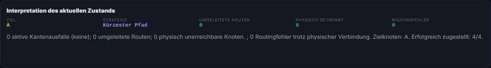
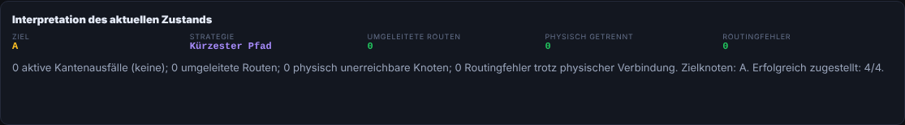

# Ausgangsstand und gemeinsame Basis der Weiterentwicklung

Stand: 26. November 2026 · Zweig `claude/basis-fehlerbehebungen`

Dieses Dokument beschreibt, worauf alle Änderungspakete aufbauen. Es gehört
nicht zum Stand der Bachelorarbeit. Die Evaluationsergebnisse der Arbeit
bleiben ihrem damals untersuchten Stand zugeordnet.

## 1. Gesicherte Stände

Alle Stände liegen unverändert auf GitHub. Tags ließen sich aus der
Cloud-Umgebung nicht hochladen (HTTP 403); die Sicherung erfolgt deshalb über
Zweige, die auf die jeweiligen Commits zeigen.

| Zweig | Commit | Bedeutung |
|---|---|---|
| `claude/referenz-bachelorarbeit-ed3b68c` | `ed3b68c36485f9a14062958832bc3fd9693e3975` | technischer Referenzstand der Arbeit laut `README.md` und Studienprotokoll |
| `claude/referenz-vor-weiterentwicklung-99c2962` | `99c2962962cc706f88a38af34254a180003d55ab` | letzter Stand vor der Weiterentwicklung laut `docs/DRAGGABLE_NODES.md` |
| `claude/ausgangsstand-main-ba4c99a` | `ba4c99ae7fc0209bfe7eb12aa0cca3956cab8790` | Stand von `main` zu Beginn dieser Arbeit |

Welcher der beiden Referenz-Commits dem abgegebenen Stand entspricht, geht aus
dem Repository nicht eindeutig hervor. `main` und das Deployment wurden nicht
verändert.

## 2. Was der Ausgangsstand `ba4c99a` bereits enthält

- Import von TopoHub-JSON, SNDlib-XML und GraphML (FA-01)
- Zielknoten, Routingverfahren und Routingmetrik wählen (FA-02, FA-04, FA-05)
- kürzeste Pfade und Bonsai-Greedy mit Aboreszenzen (FA-06 bis FA-09)
- Kanten ausfallen lassen und wiederherstellen (FA-03, FA-11)
- kritische Ausfallsuche (FA-12)
- Zoom, Verschieben der Ansicht, Einpassen, Knotenkürzel, Namensanzeige
- Routenhervorhebung einschließlich „Keine Route hervorheben“
- einklappbarer Ergebnisbereich, Routingzusammenfassung, Ereignisprotokoll
- **einzelne Knoten verschieben und Knotenpositionen zurücksetzen**
  (Commit `ba4c99a`, nach der Bachelorarbeit entstanden; die Browserprüfung
  dazu war dort noch offen)
- Szenarioserialisierung **nur im Domänenkern** (FA-14): JSON-Schema,
  Export- und Importfunktionen, aber keine API und keine Bedienelemente

Nicht enthalten: besser sichtbare graue Kanten, Speichern und Laden von
Szenarien über die Oberfläche, Windows-Programm.

## 3. Zuordnung der bereits veröffentlichten Commits

Der Sitzungszweig `claude/gallant-fermat-h4hdmg` enthielt aus der ersten
Sitzung zwei Commits. Sie bleiben dort unverändert bestehen. Ihr Inhalt wurde
für die Paketzweige neu aufgeteilt, damit die Pakete einzeln wählbar sind:

| Inhalt aus `c09e312` / `4f8f4d1` | Jetzt in |
|---|---|
| erneuter Import derselben Datei | Basis |
| Mausrad scrollt die Seite nicht mehr mit | Basis |
| Schreibfehler im Interpretationstext | Basis |
| Browser-Prüfskript, 50-Knoten-Testtopologie | Basis (Prüfgruppen je Paket) |
| graue Kanten deckend in `#64708a` | Paket 1 |
| Protokoll der Browserprüfung zum Knotenverschieben | Paket 2 |

## 4. Gemeinsame Fehlerbehebungen

Die drei Korrekturen betreffen Abläufe, die mehrere Pakete benutzen. Sie
ändern weder Layout noch Farben.

### F-01 Dieselbe Datei erneut importieren

**Problem.** Wurde dieselbe Datei ein zweites Mal gewählt, löste die
Oberfläche keinen Import aus (im Test 0 Anfragen an das Backend).
**Ursache.** Das Dateifeld behielt seinen Wert; der Browser meldet dann keine
Änderung. **Änderung.** `src/components/FileUploader.jsx` leert das Feld nach
jeder Auswahl. **Prüfung.** B-1: vorher 0 Anfragen, nachher 1 Anfrage.

### F-02 Mausrad über dem Graphen

**Problem.** Beim Zoomen mit dem Mausrad scrollte zusätzlich die Seite (im
Test um 16 Pixel), und der Browser meldete jedes Mal „Unable to preventDefault
inside passive event listener invocation“. **Ursache.** React registriert
`onWheel` passiv. **Änderung.** `src/hooks/useGraphViewport.js` registriert
den Listener direkt und nicht passiv. Das Zoomverhalten ist gleich.
**Prüfung.** B-2 und B-3: vorher `scrollY` 16 und ein Konsolenfehler, nachher
`scrollY` 0 und kein Konsolenfehler.

### Ä-02 Text „Interpretation des aktuellen Zustands“ (sichtbar)

**Problem.** „Kantenausfalle“ statt „Kantenausfälle“ sowie die Zeichenfolge
„. ;“. **Änderung.** Nur Schreibweise und Satzzeichen; Inhalt, Reihenfolge und
Begriffe bleiben. Die Textbildung liegt in `src/utils/interpretation.js`.

| | Text bei 0 Ausfällen |
|---|---|
| Vorher | 0 aktive Kantenausfalle (keine); 0 umgeleitete Routen; 0 physisch unerreichbare Knoten. ; 0 Routingfehler trotz physischer Verbindung. Zielknoten: A. Erfolgreich zugestellt: 4/4. |
| Nachher | 0 aktive Kantenausfälle (keine); 0 umgeleitete Routen; 0 physisch unerreichbare Knoten; 0 Routingfehler trotz physischer Verbindung. Zielknoten: A. Erfolgreich zugestellt: 4/4. |

| Vorher | Nachher |
|---|---|
|  |  |

**Prüfung.** B-4 im Browser; vier Tests in
`tests/frontend/interpretation.test.js`.

## 5. Browserprüfung

`tests/browser/run-checks.cjs` führt alle Prüfgruppen unter
`tests/browser/checks/` aus. Jedes Paket bringt seine eigene Gruppe mit.

```bash
npm run dev:api
```

```bash
npm run dev
```

```bash
node tests/browser/run-checks.cjs
```

Das Skript ist nicht Teil der CI. Es braucht eine lokale
Playwright-Installation mit Chromium. Mit `CHECKS=10,20` lassen sich einzelne
Gruppen wählen; ein zweites Argument nennt einen Ordner für Screenshots.

Prüfumgebung dieser Arbeit: Chromium 158 (headless) über Playwright,
1440 × 900 CSS-Pixel, Linux-Container. Nicht geprüft: andere Browser, Touch,
Bildschirmleser, Nutzung durch Personen.

`tests/fixtures/synthetic_50_nodes.json` ist eine künstlich erzeugte Topologie
mit 50 Knoten und 65 Kanten, keine reale Netztopologie.

## 6. Ergebnis auf diesem Zweig

- Browserprüfung Basis: 5 von 5 bestanden.
- `npm run test:frontend`: 27 Tests bestanden.
- `python -m pytest -q`: 52 Tests bestanden.
- `npm run lint` und `npm run build`: bestanden.

Die Einträge belegen, dass die beschriebenen Fehler im Test nicht mehr
auftreten. Eine verbesserte Gebrauchstauglichkeit ist damit nicht belegt.
