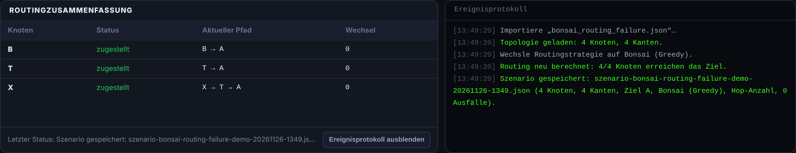
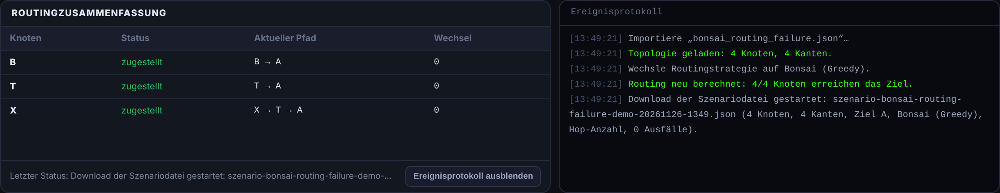

# Korrektur der Meldung nach „Szenario speichern“

Stand: 26. November 2026 · Zweig `claude/paket-5-bildexport`
Baut auf: Paket 3 (Szenarien speichern und laden) · Hängt vom Bildexport ab: nein

## Problem

Nach „Szenario speichern“ stand im Ereignisprotokoll und in der Statuszeile
„Letzter Status“ der Text „Szenario gespeichert: <Datei> (…)“, im Protokoll in
Grün.

Die Seite löst damit aber nur einen **Download** aus. Ob danach eine Datei auf
dem Datenträger liegt, entscheidet der Browser. Im Windows-Programm öffnet sich
der Dialog „Speichern unter“, der sich auch abbrechen lässt. Davon erfährt die
Seite nichts. Die Meldung behauptete damit mehr, als die Anwendung wissen kann.

## Änderung

Eine Zeile in `src/hooks/useRoutingSimulator.js` (Funktion `saveScenario`):

| | Vorher | Nachher |
|---|---|---|
| Text | „Szenario gespeichert: <Datei> (<Kurzbeschreibung>).“ | „Download der Szenariodatei gestartet: <Datei> (<Kurzbeschreibung>).“ |
| Art des Eintrags | Erfolg (Protokollzeile grün) | Information (Protokollzeile grau) |

Die Art des Eintrags wurde mit geändert, weil eine grüne Zeile im Protokoll
„erfolgreich abgeschlossen“ bedeutet und das hier nicht bestätigt ist.

Nicht geändert:

- Die Beschriftung „Szenario speichern“ und ihr Tooltip. Sie benennen, was die
  nutzende Person erreichen will.
- „FEHLER: Szenario nicht gespeichert. …“, wenn das Backend die Datei nicht
  erzeugen kann. Dort ist die Aussage zutreffend, denn es wurde nichts zum
  Download bereitgestellt.
- Dateiinhalt, Dateiname und Ablauf des Speicherns.

## Vorher / Nachher

Statuszeile (links unten) und Ereignisprotokoll (rechts) nach „Szenario
speichern“ mit der Beispieltopologie `bonsai_routing_failure.json`:

Vorher (Stand `aaf4bd6`):

Nachher:

## Prüfung

Browserprüfung **S-3b** in `tests/browser/checks/40-szenario.cjs`: Nach
„Szenario speichern“ beginnt die Statuszeile mit „Letzter Status: Download der
Szenariodatei gestartet: szenario-…json (4 Knoten“, das Ereignisprotokoll
enthält genau diese eine Meldung zur Szenariodatei, und weder Statuszeile noch
Protokollzeile enthalten das Wort „gespeichert“.

Die Prüfung schlägt am Stand davor fehl (dort steht „Szenario gespeichert: …“)
und besteht mit der Änderung. Die übrigen Prüfungen der Gruppe bestehen
unverändert (24 von 24 mit der neuen).

## Abhängigkeiten

- Hängt von **Paket 3** ab: Die Meldung entsteht dort. Ohne Paket 3 gibt es
  nichts zu ändern.
- Hängt **nicht** vom Bildexport ab und umgekehrt. Beide Änderungen liegen in
  getrennten Commits; der Bildexport verwendet dieselbe Unterscheidung (siehe
  [PAKET_5_BILDEXPORT.md](PAKET_5_BILDEXPORT.md)), aber keinen gemeinsamen Code.

## Grenzen

- Die Meldung sagt nicht, ob die Datei gespeichert wurde. Das kann die Seite
  nicht feststellen.
- Geprüft wurde der Wortlaut in der Oberfläche, nicht, wie Nutzende die
  Meldung verstehen. Eine verbesserte Gebrauchstauglichkeit ist nicht belegt.
