# Paket 1: Kantenlesbarkeit

Stand: 25. November 2026 · Zweig `claude/paket-1-kantenlesbarkeit`
Baut auf: `claude/basis-fehlerbehebungen` · Abhängigkeit von anderen Paketen: keine

## Problem

Kanten, die auf keiner Route liegen, wurden mit `#31394d` und 35 % Deckkraft
auf dem Flächenhintergrund `#131720` gezeichnet. Das ergibt rechnerisch einen
Kontrast von 1,14:1. Mit „Keine Route hervorheben“ betrifft das alle Kanten;
die Verbindungen der Topologie sind dann kaum zu erkennen. Im Normalfall
betrifft es die Kanten, die bei einem Ausfall als Ausweichweg in Frage kommen.
Die Legende erklärte die graue Kante nicht.

## Umsetzung

- Kanten ohne Route verwenden den bereits in der Oberfläche vorhandenen
  Grauton `#64708a` und werden deckend gezeichnet
  (`EDGE_IDLE` in `src/styles/sharedStyles.js`).
- Die Legende erhält einen Eintrag „Kante ohne Route“ im vorhandenen Stil.
- Strichstärke, Linienart und alle übrigen Farben bleiben gleich. Grün bleibt
  die aktuelle Route, Violett die Route vor dem Ausfall beziehungsweise die
  Aboreszenz, Rot gestrichelt die ausgefallene Kante.

Als Richtwert dient die Mindestanforderung 3:1 für grafische Objekte aus
WCAG 2.1, Erfolgskriterium 1.4.11.

| | Vorher | Nachher |
|---|---|---|
| Farbe / Deckkraft | `#31394d` / 0,35 | `#64708a` / 1 |
| Kontrast zum Hintergrund | 1,14:1 | 3,61:1 |
| Aktuelle Route (Grün) | 13,23:1 | unverändert |
| Route vor dem Ausfall (Violett) | 6,79:1 | unverändert |
| Ausgefallene Kante (Rot) | 5,17:1 | unverändert |
| Legendeneintrag für Grau | fehlt | „Kante ohne Route“ |

## Vorher-/Nachher-Vergleich

Kleine Topologie (`bonsai_routing_failure.json`), Normalbetrieb:

| Vorher | Nachher |
|---|---|
|  | 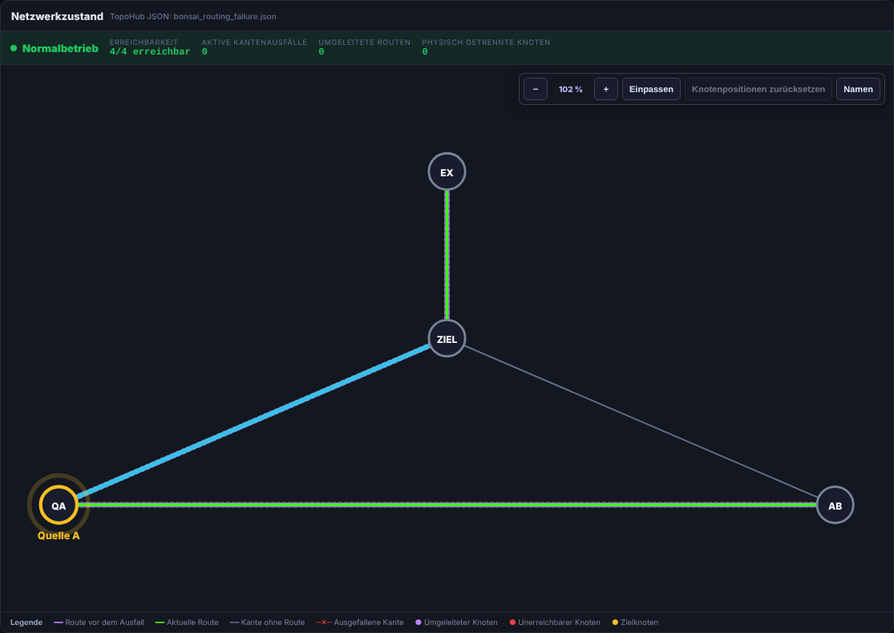 |

Kleine Topologie mit einem Kantenausfall:

| Vorher | Nachher |
|---|---|
| 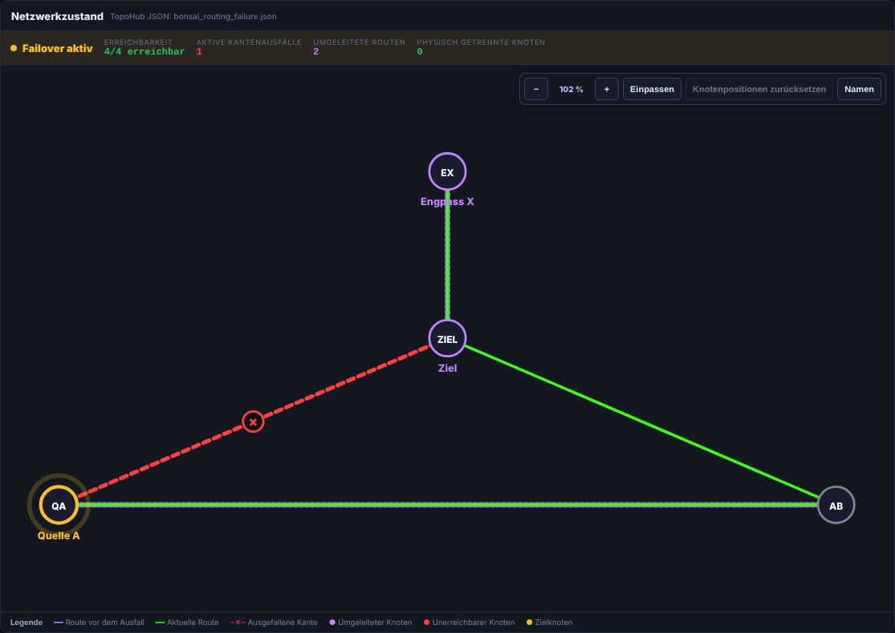 | 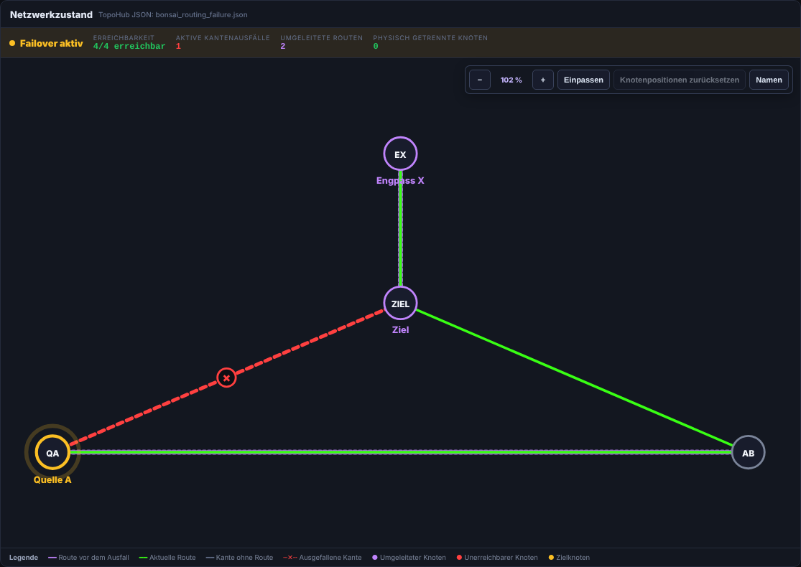 |

Kleine Topologie im Bonsai-Modus:

| Vorher | Nachher |
|---|---|
| 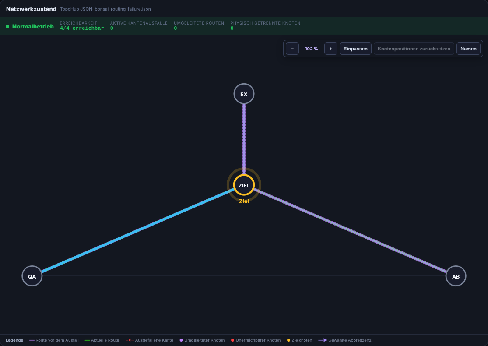 | 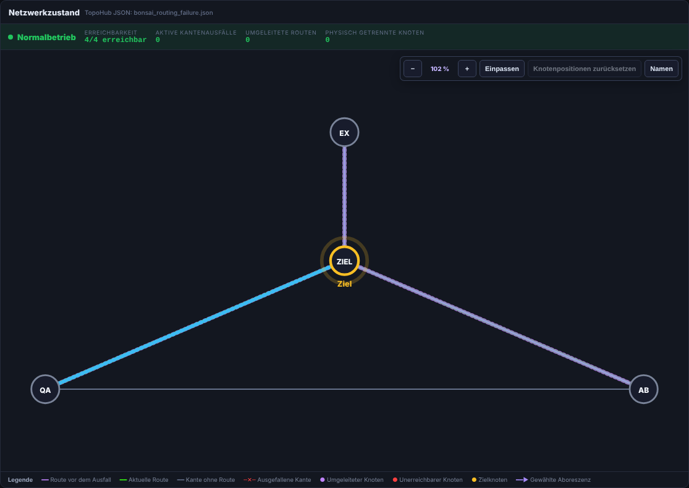 |

50 Knoten, 65 Kanten, „Keine Route hervorheben“:

| Vorher | Nachher |
|---|---|
| 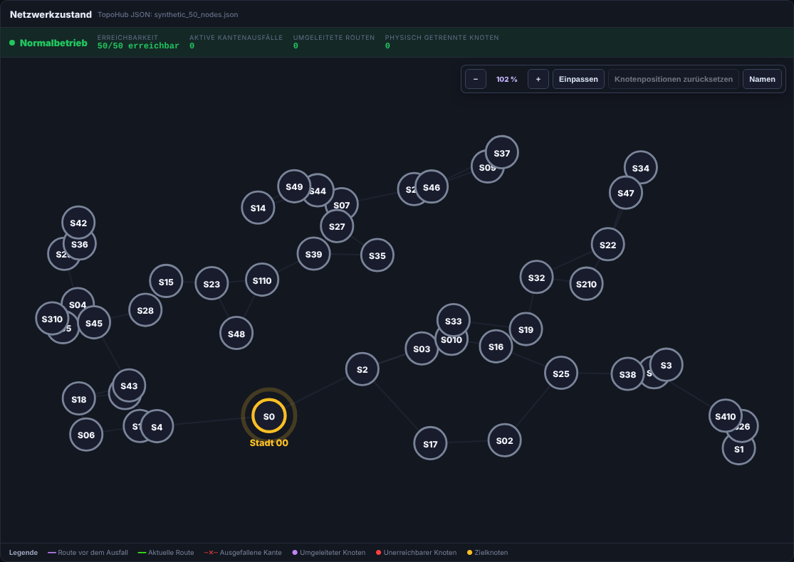 | 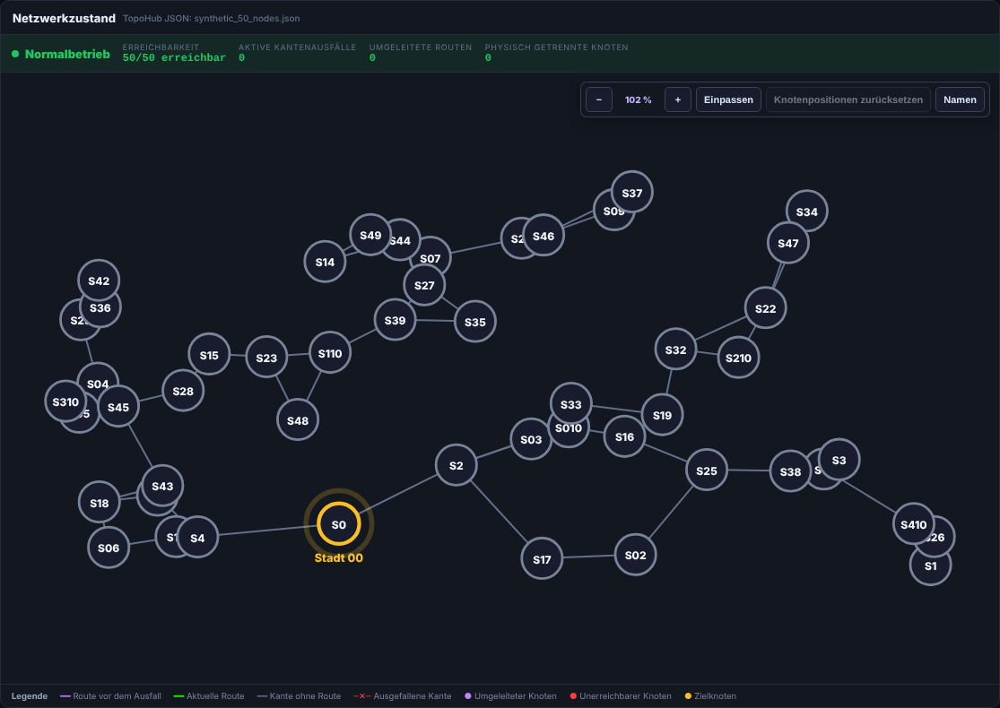 |

50 Knoten, 65 Kanten, „Alle Routen“:

| Vorher | Nachher |
|---|---|
| 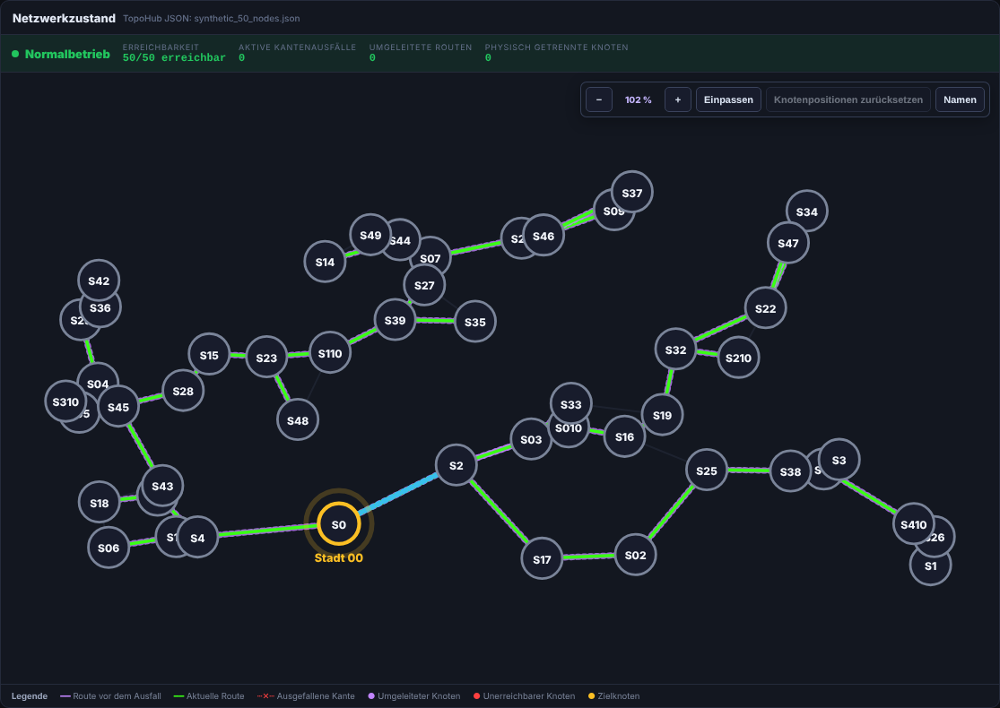 | 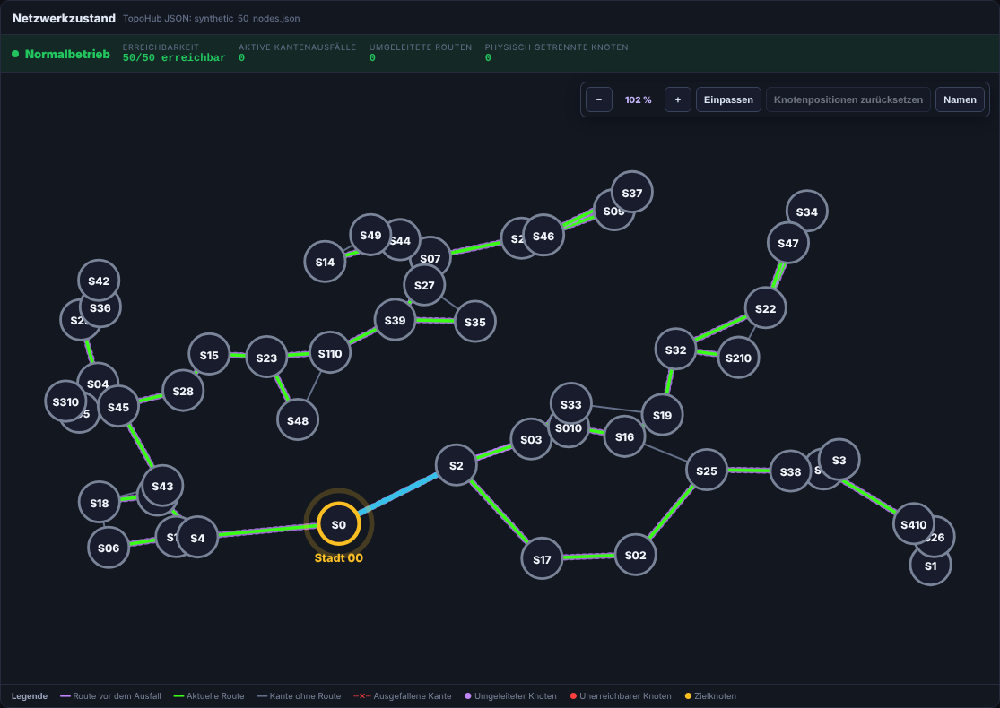 |

50 Knoten, 96 Kanten (dichter), „Alle Routen“:

| Vorher | Nachher |
|---|---|
| 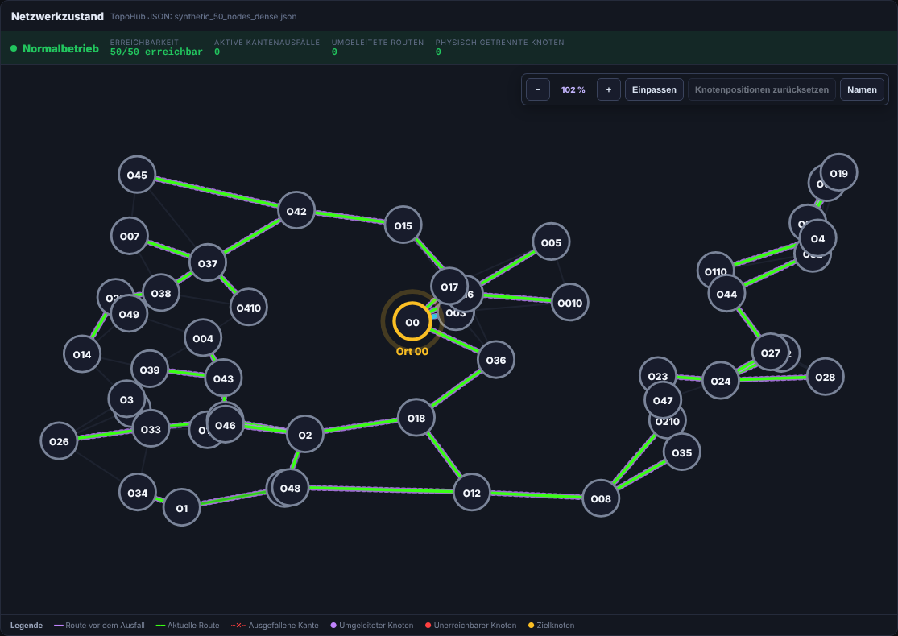 | 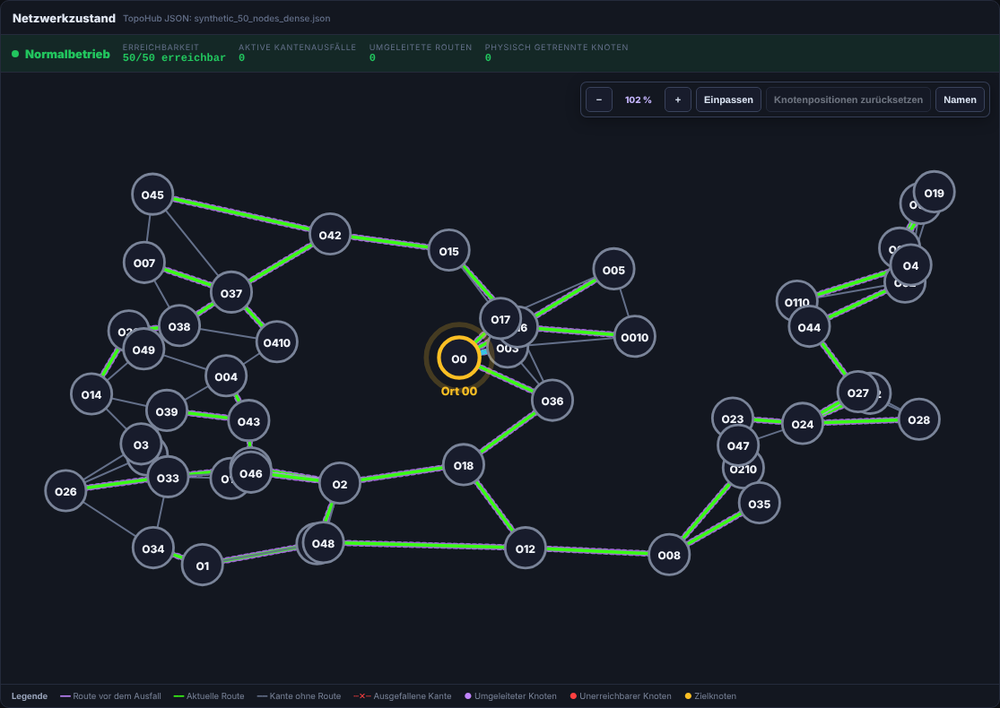 |

50 Knoten, 96 Kanten, mit Kantenausfällen:

| Vorher | Nachher |
|---|---|
| 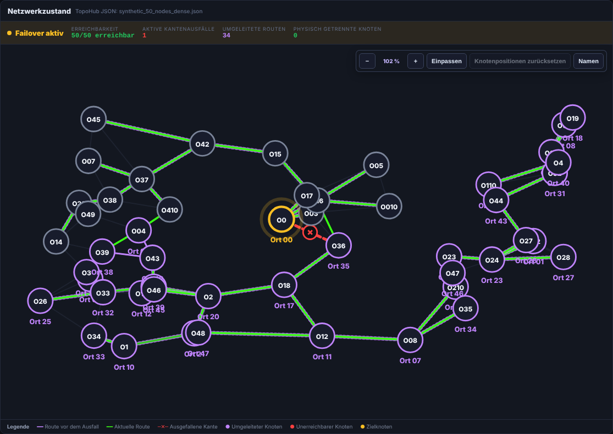 | 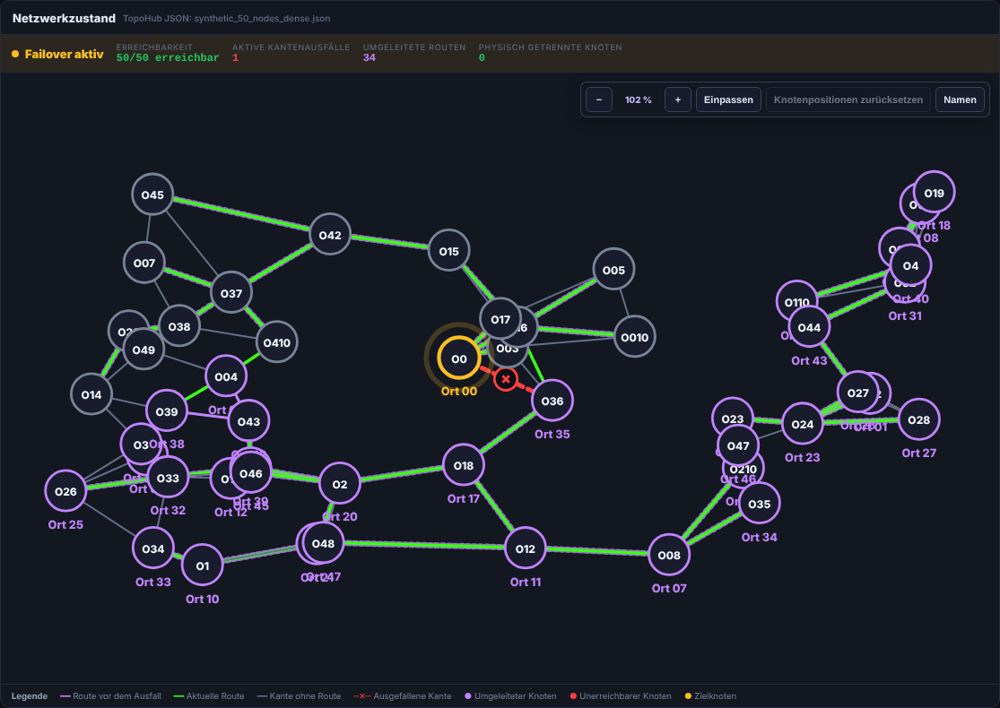 |

## Tatsächliche Prüfung

Browserprüfung `tests/browser/checks/20-kanten.cjs`, vor und nach der Änderung
mit demselben Skript ausgeführt:

| ID | Prüfung | Vorher | Nachher |
|---|---|---|---|
| K-1 | Kante ohne Route: Kontrast mindestens 3:1 | nicht bestanden (1,14:1) | bestanden (3,61:1) |
| K-2 | Aktuelle Route bleibt grün und kontraststärker als Grau | bestanden | bestanden |
| K-3 | Ausgefallene Kante bleibt rot gestrichelt und kontraststärker | bestanden | bestanden |
| K-4 | Kante ohne Route ist durchgezogen, also von der Ausfalllinie unterscheidbar | bestanden | bestanden |
| K-5 | Legende erklärt die graue Kante | nicht bestanden | bestanden |
| K-6 | Aboreszenzpfeile bleiben im Bonsai-Modus vorhanden | bestanden | bestanden |
| K-7 | Dichte Topologie: alle 47 Kanten ohne Route erreichen 3:1 | nicht bestanden (1,14:1) | bestanden (3,61:1) |

Dazu der automatische Test `tests/frontend/edgeContrast.test.js`: mindestens
3:1, und Routen- sowie Ausfallfarben bleiben kontraststärker als Grau.

Die Kontrastwerte wurden aus der im Browser tatsächlich gezeichneten Farbe und
Deckkraft berechnet. Die Screenshots wurden gesichtet.

## Grenzen

- Nicht belegt ist, ob Nutzende Kanten jetzt schneller finden oder Aufgaben
  besser lösen. Es gab keine Prüfung mit Personen.
- Die großen Topologien sind künstlich erzeugt. Atlanta und Germany50 liegen
  nicht im Repository und waren aus der Prüfumgebung nicht abrufbar.
- In der dichten Topologie werden die grauen Kanten zwischen eng liegenden
  Knoten deutlicher sichtbar als zuvor. Die Routen bleiben in den Aufnahmen
  klar dominant; ob das als unruhiger empfunden wird, ist nicht untersucht.
- Farbfehlsichtigkeit wurde nicht gesondert geprüft. Grau und Rot
  unterscheiden sich zusätzlich durch die Linienart (durchgezogen/gestrichelt
  mit Kreuz).
- Die Pfeilspitzen der Aboreszenz liegen unter den Knotenkreisen. Das ist
  unabhängig von diesem Paket und wird in Paket 2 behandelt.
