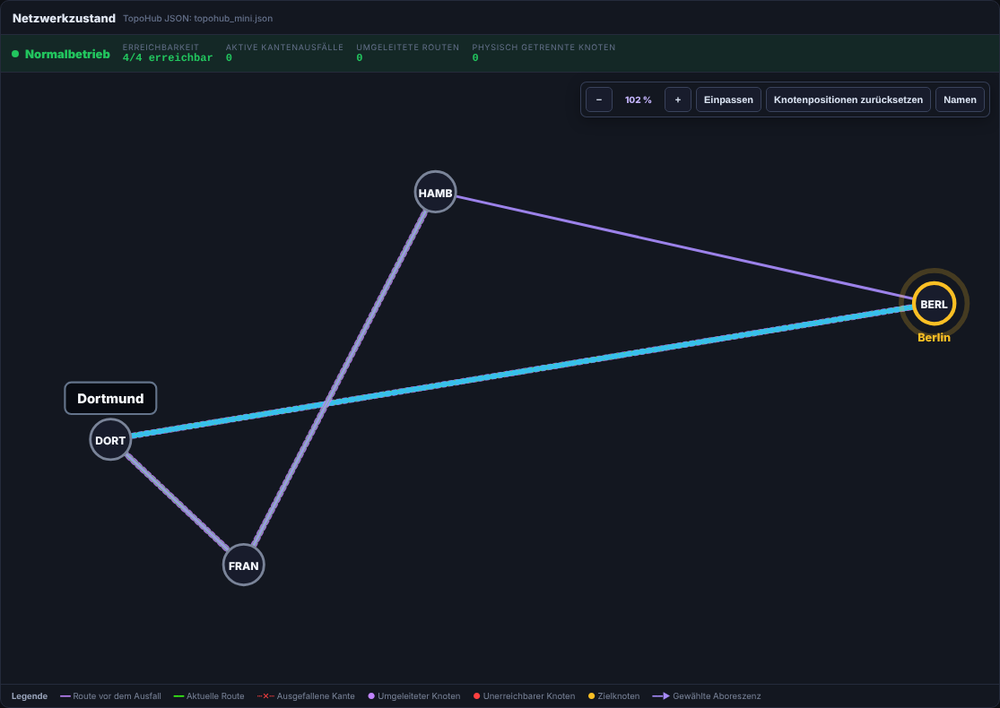
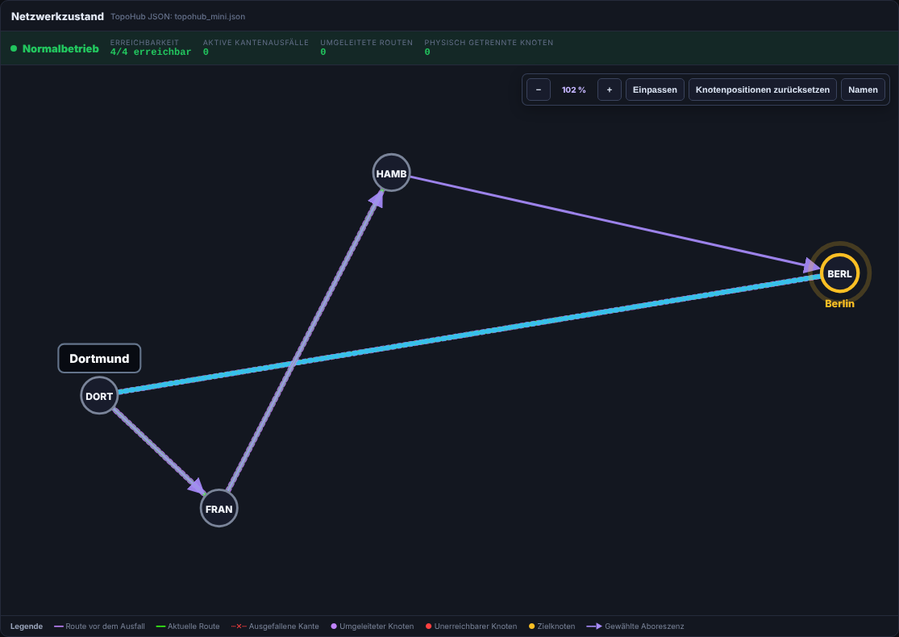
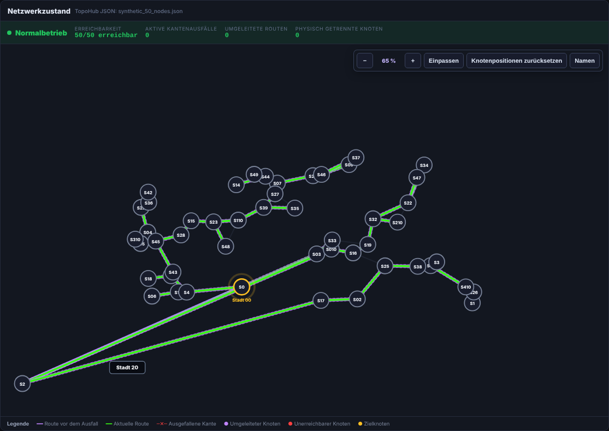
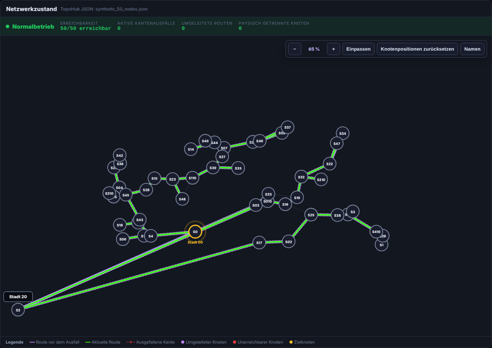
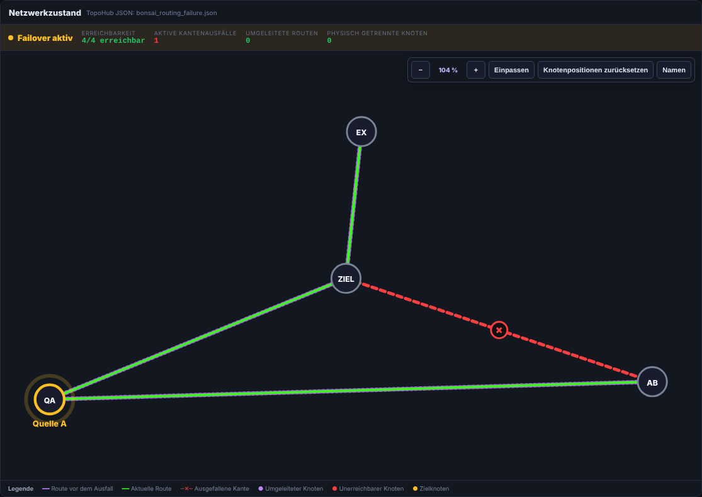

# Paket 2: Knotenverschieben

Stand: 25. November 2026 · Zweig `claude/paket-2-knotenverschieben`
Baut auf: `claude/basis-fehlerbehebungen` · Abhängigkeit von anderen Paketen: keine

Das Verschieben einzelner Knoten ist bereits im Ausgangsstand `ba4c99a`
enthalten. Seine Browserprüfung war dort offen. Dieses Paket holt die Prüfung
nach und behebt die dabei gefundenen Fehler. Die Bedienung selbst steht in
[DRAGGABLE_NODES.md](../DRAGGABLE_NODES.md).

## Gefundene Probleme

| Nr. | Problem | Wie festgestellt |
|---|---|---|
| P2-1 | Ein Knoten ließ sich aus der Graphfläche herausziehen, etwa hinter die Seitenleiste. Er war danach nicht mehr sichtbar. | N-9c: Knotenmitte bei x = 100, Graphfläche beginnt bei x = 306 |
| P2-2 | Lag ein verschobener Knoten außerhalb des ursprünglichen Zeichenbereichs, erschien sein Namens-Tooltip weit entfernt. | N-11a: 212 Einheiten seitlicher Versatz |
| P2-3 | Die Pfeilspitzen der Aboreszenz endeten in der Knotenmitte und wurden vom Knotenkreis verdeckt. Die Richtung war nicht ablesbar. Das war schon vor dem Knotenverschieben so (vgl. Screenshot S-03). | N-7b: Abstand der Pfeilspitze zur Knotenmitte 0 |

Keine Fehler zeigten sich bei: Beschriftungen, verbundenen Kanten,
Ausfallmarkierungen, Zoom, Verschieben der Gesamtansicht, Einstellungswechseln,
Zurücksetzen und erneutem Import.

## Umsetzung

Commit „keep dragged nodes and their tooltip inside the visible graph area“:

- P2-1: Beim Ziehen eines Knotens wird die Knotenmitte auf die sichtbare
  Graphfläche begrenzt (`clampPointToRect`, `src/hooks/useGraphViewport.js`),
  unabhängig davon, wo der Knoten gegriffen wurde. Der Knoten bleibt am Rand
  stehen. Das Verschieben der Gesamtansicht ist
  davon nicht betroffen.
- P2-2: Der Tooltip richtet sich nach dem sichtbaren Ausschnitt statt nach dem
  festen Bereich 0 bis 800 (`placeNodeTooltip`, `visibleGraphBounds`).

Commit „end arborescence arrows at the node edge“ (getrennt, weil sichtbar):

- P2-3: Die Pfeillinie endet 19 Einheiten vor der Mitte des Zielknotens
  (Radius 16), sodass die Spitze am Knotenrand sichtbar ist
  (`shortenSegmentEnd`). Farbe, Strichstärke und Bedeutung bleiben gleich.

Positionsänderungen bleiben reiner Darstellungszustand im Frontend. Topologie,
importierte Koordinaten und Routingergebnisse werden nicht verändert.

## Vorher-/Nachher-Vergleich

Aboreszenzpfeile (`topohub_mini.json`, Bonsai, zweiter Baum, ein Knoten
verschoben):

| Vorher | Nachher |
|---|---|
|  |  |

Tooltip an einem weit nach links unten verschobenen Knoten (50 Knoten,
herausgezoomt):

| Vorher | Nachher |
|---|---|
|  |  |

Ausfallmarkierung zwischen zwei verschobenen Knoten (nachher; vorher ebenfalls
korrekt):

## Tatsächliche Prüfung

Browserprüfung `tests/browser/checks/30-knoten.cjs`, mit demselben Skript vor
und nach den Änderungen ausgeführt: vorher 29 von 33, nachher 33 von 33.

| ID | Prüfung | Vorher | Nachher |
|---|---|---|---|
| N-1a | Ziehen bewegt nur den gezogenen Knoten | bestanden | bestanden |
| N-1b | Verbundene Kante endet am verschobenen Knoten | bestanden | bestanden |
| N-1c | Beschriftung folgt dem Knoten | bestanden | bestanden |
| N-1d | Verschieben löst keine API-Anfrage aus | bestanden | bestanden |
| N-1e | Routingzusammenfassung und Kennzahlen bleiben unverändert | bestanden | bestanden |
| N-2a | Knoten bleibt nach Herauszoomen und Verschieben der Ansicht unter der Maus | bestanden | bestanden |
| N-2b | Knoten bleibt auch hineingezoomt unter der Maus | bestanden | bestanden |
| N-3a | Kantenausfall erhält die manuelle Position | bestanden | bestanden |
| N-3b | Kantenausfall wird fachlich ausgewiesen | bestanden | bestanden |
| N-3c | Erneuter Klick stellt die Kante wieder her | bestanden | bestanden |
| N-4a | Ziel, Metrik, Routenhervorhebung und Verfahren erhalten die Anordnung | bestanden | bestanden |
| N-4b | Wechsel der angezeigten Aboreszenz erhält die Anordnung (2 Bäume) | bestanden | bestanden |
| N-5 | Kreuzmarkierung liegt auf der Mitte zwischen den verschobenen Knoten | bestanden | bestanden |
| N-6 | „Einpassen“ behält die manuelle Anordnung | bestanden | bestanden |
| N-7a | Aboreszenzpfeil beginnt am verschobenen Knoten | bestanden | bestanden |
| N-7b | Pfeilspitze endet sichtbar am Rand des Zielknotens | **nicht bestanden** | bestanden |
| N-7c | Aboreszenzpfeil folgt dem verschobenen Knoten | bestanden | bestanden |
| N-8a | Zurücksetzen stellt die ursprünglichen Positionen wieder her | bestanden | bestanden |
| N-8b | Zurücksetzen erhält die Ausfälle | bestanden | bestanden |
| N-8c | Schaltfläche ist danach wieder inaktiv | bestanden | bestanden |
| N-8d | Fachlicher Zustand entspricht wieder dem Ausgang | bestanden | bestanden |
| N-9a | Nach Loslassen außerhalb hängt kein Knoten an der Maus | bestanden | bestanden |
| N-9b | Drag außerhalb löst keinen Kantenausfall aus | bestanden | bestanden |
| N-9c | Knoten bleibt in der sichtbaren Graphfläche | **nicht bestanden** | bestanden |
| N-9d | Loslassen über einer Kante löst keinen Kantenausfall aus | bestanden | bestanden |
| N-9e | Am Rand gegriffen bei 600 % Zoom: Knotenmitte bleibt in der Graphfläche | **nicht bestanden** | bestanden |
| N-10a | Andere Topologie: keine Anordnung übernommen | bestanden | bestanden |
| N-10b | Erneuter Import nach Topologiewechsel: ursprüngliche Positionen | bestanden | bestanden |
| N-10c | Dieselbe Datei direkt erneut importiert: ursprüngliche Positionen | bestanden | bestanden |
| N-11a | Tooltip erscheint am weit verschobenen Knoten | **nicht bestanden** | bestanden |
| N-11b | Tooltip liegt vollständig in der sichtbaren Graphfläche | bestanden | bestanden |
| N-12 | Werkzeugleiste bleibt bei 900 px Breite in der Graphfläche | bestanden | bestanden |
| N-13 | Keine Konsolenfehler | bestanden | bestanden |

„Vorher“ ist der Basiszweig. N-10c setzt die Korrektur F-01 der Basis voraus;
im Ausgangsstand `ba4c99a` löste der direkte erneute Import nichts aus.

Automatische Tests: `tests/frontend/graphLayoutStability.test.js` (8 Tests)
zusätzlich zu den bestehenden 8 Geometrietests. Die bestehenden Tests prüfen
weiterhin, dass `applyNodePositions` Topologiedaten und Routingmerkmale nicht
verändert.

## Grenzen

- Geprüft wurde ein automatisierter Mausablauf in Chromium. Touch, andere
  Browser und Nutzung durch Personen sind nicht geprüft.
- Knoten lassen sich weiterhin nicht per Tastatur verschieben.
- Die Anordnung geht beim Neuladen der Seite verloren. Paket 3 enthält einen
  getrennten, optionalen Commit, der sie in einem Szenario mitspeichert.
- Der Tooltip skaliert wie bisher mit der Zoomstufe.
- Bei sehr kurzen Kanten (unter 38 Einheiten, also bei fast überlappenden
  Knoten) endet der Pfeil in der Kantenmitte und die Spitze bleibt verdeckt.
  In der dichten Testtopologie betrifft das 14 von 49 Pfeilen.
- Ein Knoten kann am Rand der Graphfläche unter der Werkzeugleiste liegen. Er
  bleibt dort greifbar, sobald die Ansicht verschoben oder eingepasst wird.
