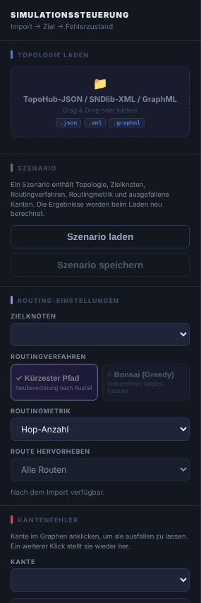

# Paket 3: Szenarien über die Oberfläche speichern und laden

Stand: 25. November 2026 · Zweig `claude/paket-3-szenarien`
Baut auf: `claude/basis-fehlerbehebungen` · Abhängigkeit von anderen Paketen: keine

## Problem

Anwendungsfall aus dem Auftrag: eine Konfiguration exportieren, weitergeben
und auf einem anderen Rechner mit denselben fachlichen Einstellungen und
Ausfällen wieder öffnen. Der Anwendungsfall selbst ist im Repository nicht
beschrieben; er stammt aus der Aufgabenstellung für diese Weiterentwicklung.

Der Ausgangsstand konnte Szenarien nur im Domänenkern serialisieren (FA-14).
Es gab keine API-Anbindung und kein Bedienelement. Sitzungen liegen nur im
Arbeitsspeicher des Backends und gehen bei jedem Neustart verloren.

## Umsetzung

### Dateiformat

Verwendet wird das vorhandene Schema
`backend/schemas/failover-scenario.schema.json` mit `format_version` „1.0“.
Eine gespeicherte Datei enthält:

| Feld | Inhalt |
|---|---|
| `topology` | Knoten, Kanten, Gewichte und die importierten Koordinaten |
| `routing` | Zielknoten, Routingverfahren, Routingmetrik |
| `failures` | ausgefallene Kanten |
| `routing_snapshot` | Pfade zum Zeitpunkt des Speicherns, nur zum Vergleich |
| `scenario_id`, `name`, `created_at`, `metadata` | Verwaltungsangaben |

### API

| Methode und Pfad | Funktion |
|---|---|
| `GET /api/sessions/{session_id}/scenario` | aktuellen Zustand als Szenario ausgeben |
| `POST /api/sessions/import-scenario` | Szenario prüfen, neu berechnen und als neue Sitzung anlegen |

Beim Laden gilt:

1. Formatversion prüfen, dann Schema, dann fachliche Gültigkeit
   (Zielknoten vorhanden, ausgefallene Kanten bekannt, Verfahren unterstützt).
2. Das Routingergebnis wird **immer im Domänenkern neu berechnet**. Der
   gespeicherte `routing_snapshot` wird nur verglichen. Weicht er ab, zeigt
   die Oberfläche die Neuberechnung und einen Hinweis.
3. Erst danach wird eine Sitzung angelegt. Eine abgewiesene Datei verändert
   weder den Sitzungsspeicher noch den Zustand der Oberfläche.

Fehlermeldungen für die Oberfläche:

| Fall | Code | Meldung |
|---|---|---|
| keine Formatversion (z. B. Topologiedatei) | `missing_format_version` | „Die Datei enthält keine Formatversion („format_version“) und ist daher kein Szenario dieser Anwendung. Topologiedateien werden über „Topologie laden“ geöffnet.“ |
| andere Formatversion | `unsupported_format_version` | „Die Formatversion „2.0“ wird nicht unterstützt. Unterstützt wird: 1.0.“ |
| Formatversion ist kein Text (z. B. die Zahl 1.0) | `unsupported_format_version` | „Die Formatversion muss als Text angegeben sein, zum Beispiel "1.0".“ |
| kein JSON | `invalid_json` | „Die Datei ist kein gültiges JSON und kann nicht als Szenario gelesen werden. …“ |
| inhaltlich ungültig | `invalid_scenario` | „Das Szenario ist ungültig und wurde nicht geladen: …“ mit bis zu drei Einzelgründen |
| größer als 10 MiB | `file_too_large` | „Die Szenariodatei ist größer als 10 MiB.“ |

Die Einzelgründe bei `invalid_scenario` stammen aus der vorhandenen Validierung
und sind englisch. Lange Angaben werden gekürzt.

Wird umgekehrt eine Szenariodatei unter „Topologie laden“ gewählt, lautet die
Meldung: „Diese Datei ist ein Szenario. Szenarien werden über „Szenario laden“
geöffnet.“

Prüfung und Neuberechnung laufen außerhalb der Ereignisschleife des Servers.
Andere Anfragen werden während eines längeren Ladevorgangs weiter beantwortet.

### Änderungen am Domänenkern

- `check_format_version` und `ScenarioFormatVersionError` unterscheiden
  fehlende und nicht unterstützte Versionen.
- `import_scenario_json` weist nicht endliche Zahlen ab (`NaN`, `Infinity`
  und Werte wie `1e400`), ebenso übertief verschachtelte Dateien, und meldet
  einen nicht berechenbaren Zustand (z. B. Bonsai auf einer nicht zusammenhängenden
  Topologie) als ungültiges Szenario.
- `scenario_to_dict` behält die Reihenfolge der Knoten und Kanten bei, statt
  nach ID zu sortieren. Grund: Die Oberfläche listet Knoten und Kanten in
  dieser Reihenfolge und leitet die Knotenkürzel daraus ab. Das Routing
  sortiert selbst und hängt nicht davon ab.

Es gibt keine zweite Routingimplementierung.

### Oberfläche

Die Seitenleiste erhält unter „Topologie laden“ den Bereich „Szenario“ mit
zwei Schaltflächen im vorhandenen Stil der Schaltfläche „Alle Kanten
wiederherstellen“:

- **Szenario laden** öffnet eine gespeicherte JSON-Datei.
- **Szenario speichern** lädt den aktuellen Zustand als
  `szenario-<Topologie>-<Datum>-<Uhrzeit>.json` herunter.

Unterscheidung zum Laden einer Topologie:

- Ein kurzer Text nennt, was ein Szenario enthält.
- Nach dem Laden steht dort „Geladenes Szenario: <Datei>“. Der Bereich
  „Topologie laden“ zeigt dann keine Datei als geladen an.
- Der Bereich „Topologie laden“ nennt nur noch eine Datei, die tatsächlich
  geladen wurde. Bisher zeigte er auch den Namen einer abgewiesenen Datei.
- Fehlermeldungen erscheinen in dem Bereich, in dem die Datei gewählt wurde.
- Das Ereignisprotokoll nennt Datei, Ziel, Verfahren, Metrik und Zahl der
  Ausfälle.
- Während eine Anfrage läuft, sind „Zielknoten“ und „Routingmetrik“ gesperrt,
  wie zuvor schon die Schaltflächen. Zusätzlich darf nur die zuletzt
  gestartete Anfrage den Zustand setzen. Eine verspätete Antwort kann ein
  inzwischen geladenes Szenario dadurch nicht ersetzen.

Geladenes Bonsai-Szenario mit einem Ausfall:

Abgewiesene Datei mit nicht unterstützter Formatversion; der vorherige Zustand
bleibt bestehen:

Datei mit manipulierten gespeicherten Ergebnissen:

## Tatsächliche Prüfung

### Vollständiger Ablauf mit Neustart

Am 25. November 2026 im Browser (Chromium 158, headless) durchgeführt:
konfigurieren, Ausfälle setzen, „Szenario speichern“, **Backend-Prozess
beenden und neu starten**, neue Browsersitzung, „Szenario laden“, sichtbaren
fachlichen Zustand vergleichen (Ziel, Metrik, Verfahren, aktive Ausfälle,
Kennzahlen im Kopfbereich, vollständige Routingzusammenfassung).

| Fall | Topologie | Einstellungen | Ergebnis |
|---|---|---|---|
| Bonsai | `bonsai_routing_failure.json` | Ziel T, Bonsai, 1 Ausfall (Routingfehler durch Schleife) | Zustand identisch |
| Kürzester Pfad | `synthetic_50_nodes.json` | Ziel 12, Kantengewicht, 3 Ausfälle | Zustand identisch |

### Browserprüfung

`tests/browser/checks/40-szenario.cjs`: 23 von 23 bestanden. Geprüft werden
unter anderem Speichern und Laden für beide Verfahren nach einem Neuladen der
Seite (S-6 bis S-11), Weiterbearbeiten (S-12), erneutes Laden derselben Datei
(S-13), fünf Fehlerfälle mit unverändertem Zustand (S-14 bis S-18), eine
Szenariodatei über „Topologie laden“ (S-19), die Sperre während des Ladens
(S-19b), manipulierte Ergebnisse (S-20)
und die getrennte Anzeige beider Ladewege (S-9, S-10, S-21).

### Automatische Tests

`tests/test_scenario_api.py` (37 Tests) arbeitet mit jeweils frischen
Anwendungsinstanzen, also wie nach einem Neustart:

- Export ist schemagültig und vollständig; Koordinaten bleiben unverändert.
- Kürzester Pfad und Bonsai: Topologie, Routing, Ausfälle und Ergebnis sind
  nach Export und Import identisch, bei Bonsai einschließlich Bäumen, Routen
  und Fehlerklassen.
- Manipulierte Ergebnisse werden nicht übernommen.
- Fehlende und nicht unterstützte Version, ungültige Inhalte, Nicht-JSON,
  Topologiedatei, zu große Datei.
- Ein fehlgeschlagener Import lässt den Sitzungsspeicher unverändert.
- Zahlen außerhalb des endlichen Bereichs, übertiefe Verschachtelung und nicht
  darstellbare Zeichen führen zu einer Ablehnung statt zu einem Serverfehler.

### Unabhängige Prüfung

Ein getrennter Prüflauf hat den integrierten Stand mit 105 absichtlich
fehlerhaften oder ungewöhnlichen Dateien und Anfragen untersucht. Gefunden und
behoben wurden: Serverfehler bei drei Eingabearten, eine als gültig
angenommene unendliche Zahl, das Blockieren des Servers während eines langen
Ladevorgangs und eine verspätete Antwort, die ein geladenes Szenario ersetzen
konnte. Nach den Korrekturen meldet dasselbe Prüfskript keinen Serverfehler
mehr; während eines 3,4 Sekunden dauernden Ladevorgangs antwortete der Server
auf eine zweite Anfrage in 0,07 Sekunden.

`tests/frontend/scenarioFile.test.js` (3 Tests): Dateiname und Beschreibung.

## Grenzen

- Geprüft wurde auf einem Rechner mit neu gestartetem Backend, nicht auf zwei
  verschiedenen Rechnern oder Betriebssystemen. Die Datei enthält keine
  rechnerabhängigen Angaben.
- Zielversionen: Nur „1.0“ wird gelesen. Eine Migration älterer oder neuerer
  Formate gibt es nicht.
- Nicht gespeichert werden: die Auswahl „Route hervorheben“, die gewählte
  Aboreszenz, die Suchgrenze und das Ergebnis der automatischen Prüfung sowie
  das Ereignisprotokoll.
- Der Vergleich mit `routing_snapshot` umfasst Pfade sowie betroffene und
  geänderte Knoten, nicht die Bonsai-Einzelschritte.
- Das Speichern nutzt den Download des Browsers. Wohin die Datei gelegt wird,
  bestimmt der Browser.
- Beim Laden und erneuten Speichern werden `scenario_id`, `name`,
  `created_at` und `metadata` neu vergeben; `search_configuration` und die
  Felder `show_baseline_routes`/`show_current_routes` einer fremden Datei
  gehen verloren.
- Die Rechenzeit wächst mit der Größe der Topologie deutlich. Eine gültige
  Datei mit 2500 Knoten brauchte im Prüflauf rund 40 Sekunden. Die Grenze von
  10 MiB begrenzt die Dateigröße, nicht die Rechenzeit. Das gilt ebenso für
  den bestehenden Topologieimport.
- Sehr große Kantengewichte (um 1e308) können beim Summieren überlaufen. Ein
  solches Szenario wird abgewiesen.
- Sitzungen werden wie bisher nie aus dem Arbeitsspeicher entfernt; jedes
  Laden legt eine weitere an.
- `ARCHITECTURE.md` und `REQUIREMENTS.md` beschreiben den Stand der
  Bachelorarbeit und wurden nicht um die neuen Schnittstellen ergänzt.
- Die Datei ist nicht signiert. Sie kann von Hand verändert werden; geprüft
  wird ihre Gültigkeit, nicht ihre Herkunft.
