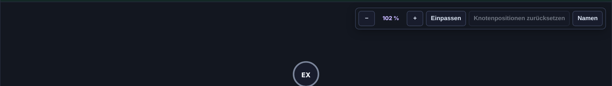
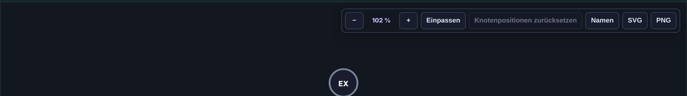
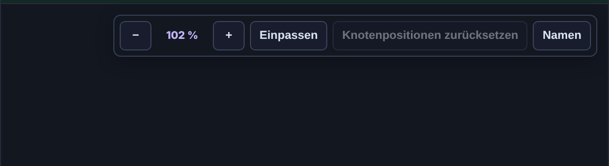
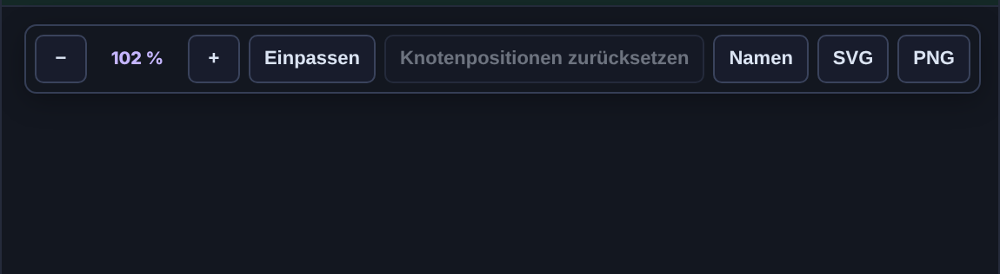
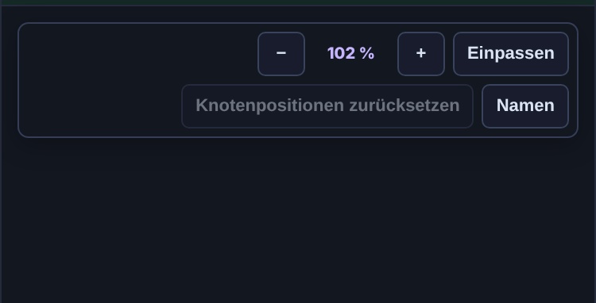
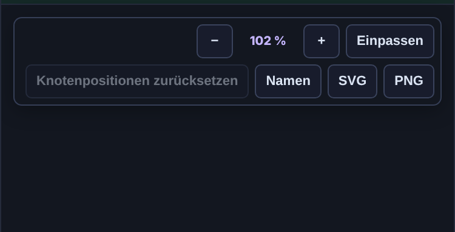
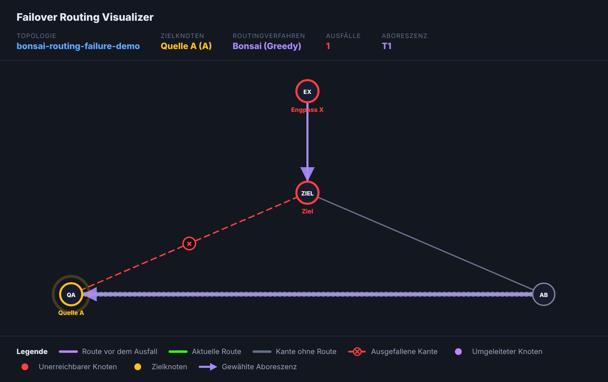
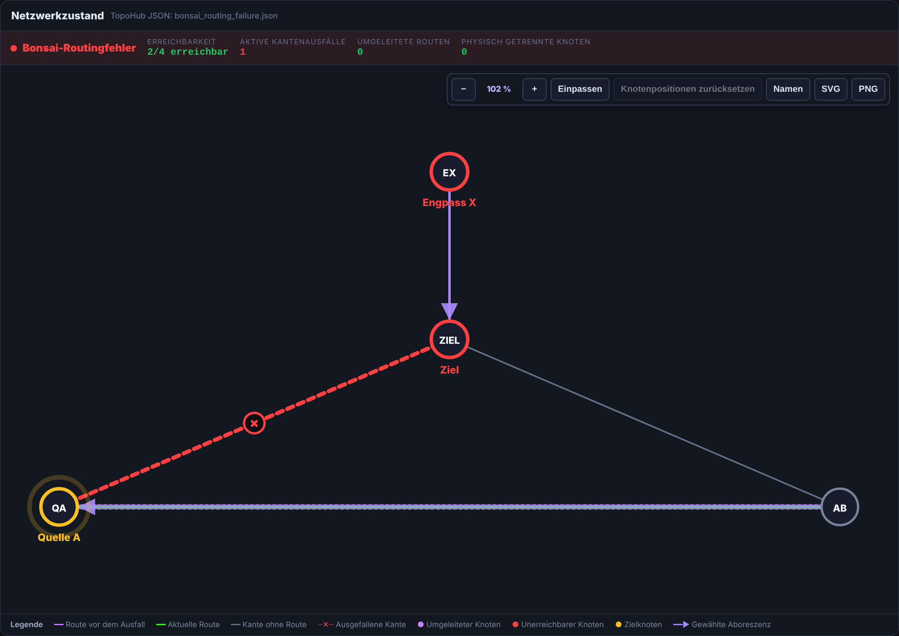
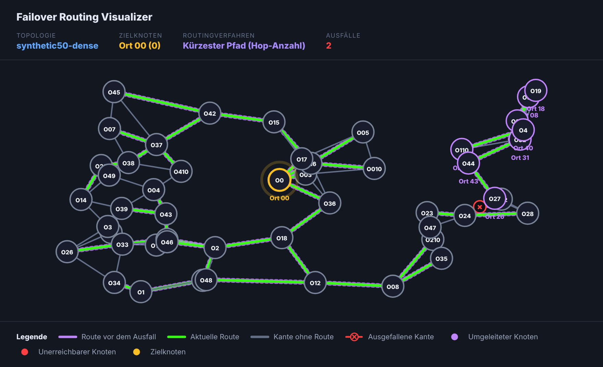
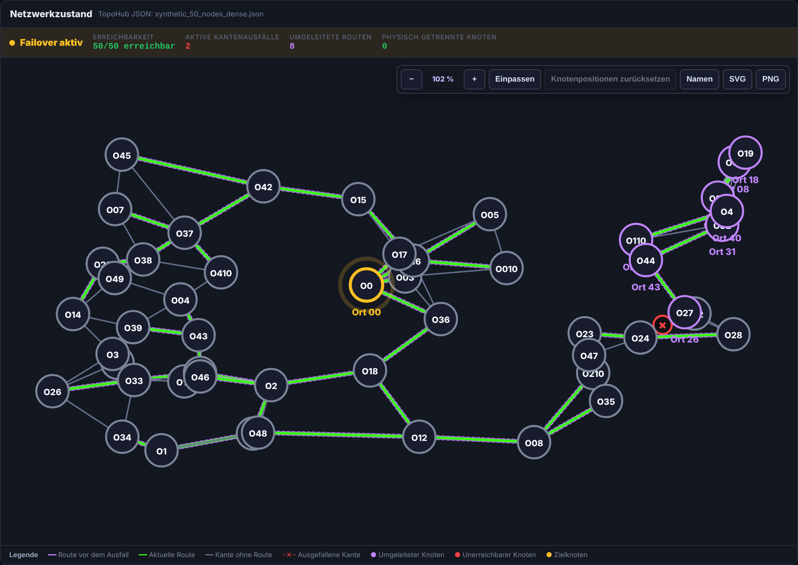

# Paket 5: Bildexport als SVG und PNG

Stand: 26. November 2026 · Zweig `claude/paket-5-bildexport`
Baut auf: `claude/integration-gesamtvorschlag` (Stand `aaf4bd6`, Code wie `439da19`)

Dieses Dokument beschreibt den Bildexport. Die Korrektur der Speichermeldung
steht getrennt in [KORREKTUR_SPEICHERMELDUNG.md](KORREKTUR_SPEICHERMELDUNG.md).
Der Plan, auf dem die Umsetzung beruht, steht in
[PLAN_BILDEXPORT.md](PLAN_BILDEXPORT.md).

## In einfachen Worten

Neben den Zoom-Schaltflächen über dem Graphen gibt es jetzt zwei weitere,
„SVG“ und „PNG“. Ein Klick lädt ein Bild der **gesamten** Topologie herunter,
so wie sie gerade eingestellt ist: mit den verschobenen Knoten, den gewählten
Routen, den Pfeilen der Aboreszenz und den ausgefallenen Kanten. Über dem Bild
stehen Topologie, Zielknoten, Routingverfahren und Zahl der Ausfälle, darunter
die Legende. Es ist egal, wie weit gerade hineingezoomt ist.

Das Programm zeichnet dafür **keinen zweiten Graphen**. Es kopiert die
Zeichnung, die auf dem Bildschirm steht, entfernt alles, was nur zum Bedienen
da ist (unsichtbare Klickflächen, Tooltip, Auswahlmarkierung, Zoom), und setzt
Kopfzeile und Legende dazu. Das PNG entsteht, indem der Browser dieses SVG auf
eine Zeichenfläche malt. Es wird nichts neu berechnet und kein Server gefragt.

Wichtig für die Aussage: Das Programm kann nur den **Download anstoßen**. Ob die
Datei danach auf der Festplatte liegt, entscheidet der Browser oder im
Windows-Programm der Speichern-Dialog. Deshalb steht im Ereignisprotokoll
„Download der SVG-Datei gestartet“ und nicht „gespeichert“.

## Problem

Wer ein Bild des Graphen für eine Arbeit oder eine Besprechung brauchte, war
auf Bildschirmfotos angewiesen. Die zeigen nur den sichtbaren Ausschnitt in der
aktuellen Fenstergröße und enthalten Bedienelemente, Tooltip und Fokusrahmen.
Ein Szenario als JSON zu speichern ist kein Bildexport.

## Festlegungen des Auftraggebers

Aus dem Auftrag vom 26. November 2026 und wie umgesetzt:

| Festlegung | Umsetzung |
|---|---|
| gesamte Topologie, unabhängig von Zoom und Ausschnitt | ja, Prüfungen E-18, E-19 |
| verschobene Knoten, gewählte Routen- und Aboreszenzanzeige | ja, E-5 bis E-7, E-21, E-23 bis E-25 |
| bestehende Farbbedeutungen, dunkler Hintergrund | ja, E-8, E-9, E-12 |
| passende Legende, knappe Kopfzeile mit Topologie, Zielknoten, Routingverfahren, Ausfällen | ja, E-9, E-10 |
| Beschriftungen und Pfeilspitzen soweit möglich im Bild | ja, E-13, E-15; überlange Namen werden gekürzt (E-35) |
| keine Bedienelemente, Tooltips, Fokusrahmen | ja, E-4, E-34 |
| SVG eigenständig, ohne Anwendung und externe Ressourcen | ja, E-3, E-4 |
| PNG mindestens 1600 Pixel breit | ja, E-11 |
| zwei verständliche Bedienelemente im vorhandenen Stil, Werkzeugleiste bei kleinen Fenstern bedienbar | ja, E-2, E-30 |
| weder Zustand noch Ansicht verändern, keine Routingberechnung | ja, E-16 |
| vorhandene Browserfunktionen, keine neue Bibliothek | ja: `cloneNode`, `getBBox`, `XMLSerializer`, `canvas` |
| keine zweite Graphdarstellung mit eigener Routinglogik | ja, siehe Technik |

## Umsetzung

### Bedienung

Am Ende der Werkzeugleiste „Graphansicht steuern“ stehen zwei Schaltflächen im
Stil der vorhandenen Schaltflächen:

- **SVG** lädt ein SVG-Bild herunter (Vektorgrafik).
- **PNG** lädt ein PNG-Bild herunter (mindestens 1600 Pixel breit).

Der Tooltip nennt die Aktion („Gesamte Topologie als SVG-Bild (Vektorgrafik)
herunterladen“), das Beschriftungsfeld für Hilfstechnik ebenso. Während einer
Berechnung sind beide gesperrt, damit kein Zwischenstand exportiert wird. Ohne
geladene Topologie gibt es die Werkzeugleiste gar nicht.

Dateiname: `graph-<Topologie>-<Datum>-<Uhrzeit>.svg` beziehungsweise `.png`,
zum Beispiel `graph-germany50-20261126-0915.svg`.

Meldung im Ereignisprotokoll und in der Statuszeile:

- `Download der SVG-Datei gestartet: <Datei>.`
- `Download der PNG-Datei gestartet: <Datei> (1760 × 1104 Pixel).`
- bei einem Fehler `FEHLER: PNG-Bild nicht erzeugt. <Grund>`

### Inhalt des Bildes

| Teil | Inhalt |
|---|---|
| Kopfzeile | „Failover Routing Visualizer“; Topologie, Zielknoten (Name und Kennung wie in der Auswahl), Routingverfahren (bei „Kürzester Pfad“ mit Metrik), Zahl der Ausfälle; bei Bonsai zusätzlich die gezeigte Aboreszenz; wenn nicht alle Routen zu sehen sind, die Routenanzeige („Route von B“, „Keine Route hervorgehoben“) |
| Zeichnung | Kanten, Knoten, Pfeile und Ausfallmarkierungen der Ansicht; Namen nach der Option „Namen“ |
| Legende | dieselben Einträge, Farben und Bezeichnungen wie unter dem Graphen; Aboreszenz nur bei Bonsai |
| Hintergrund | der dunkle Hintergrund der Graphfläche, Trennlinien wie in der Oberfläche |

Nicht im Bild: Klickflächen der Kanten, Tooltip, die hellblaue Auswahlmarkierung
der zuletzt gewählten Kante (sie hat keinen Legendeneintrag und wird beim Import
auf die erste Kante gesetzt), Zoom und Verschiebung, Fokusrahmen, Seitenleiste.
Die Linienbreite der gewählten Kante ist die einer nicht gewählten.

Die Namen richten sich nach der Option „Namen“ und nicht nach dem Zoom: Die
Ansicht blendet ab 125 % alle Namen ein, das Bild bleibt davon unberührt.
Namen über 80 Zeichen werden im Bild mit „…“ gekürzt, Werte der Kopfzeile auf
die Breite des Bildes. Die Ansicht zeigt weiterhin den vollen Namen.

### Technik

1. **Kopieren.** Die Zeichnung der Ansicht (`<g data-graph-scene>`) wird mit
   `cloneNode` kopiert. Die Ansicht selbst wird nicht verändert (geprüft:
   E-16).
2. **Aufbereiten.** Aus der Kopie fallen Elemente mit `data-export="skip"`
   (Klickflächen, Tooltip, Auswahlmarkierung), der Zoom (`transform`), Attribute
   der Bedienung (`role`, `tabindex`, `aria-label`, `style`, `vector-effect`)
   und, je nach Option, Namen von unwichtigen Knoten. Am Zeichencode der Ansicht
   ändern sich nur diese Marken (wenige `data-export*`-Attribute in
   `src/App.jsx`, die dort nichts bewirken) und die Legende, die jetzt aus der
   gemeinsamen Liste gezeichnet wird, mit gleicher Ausgabe.
3. **Messen.** Die Kopie liegt kurz unsichtbar außerhalb des Fensters, `getBBox`
   liefert ihren Umriss einschließlich der Namen; danach wird sie entfernt.
4. **Zusammensetzen.** `composeGraphImage` (reine Funktion) setzt Kopfzeile,
   Zeichnung und Legende auf den Hintergrund. Legendensymbole sind Vektorformen
   statt Schriftzeichen, damit das SVG auch dort richtig aussieht, wo ━ oder ✕
   fehlen. Die Legendenliste liegt in `graphLegend.js` und wird von der
   Oberfläche und vom Export gemeinsam benutzt; die Oberfläche zeigt dasselbe
   wie zuvor (siehe Vorher / Nachher).
5. **SVG.** Das Ergebnis wird mit `XMLSerializer` serialisiert und von
   Zeichen bereinigt, die in XML 1.0 nicht vorkommen dürfen. Es enthält
   Größe, Namensraum, `<title>` und `<desc>`, keine Verweise nach außen, keine
   Skripte und keine Schriftdatei; die Schrift ist `system-ui` mit Ersatzliste.
6. **PNG.** Das SVG wird als Bild geladen und auf eine `canvas` gemalt, mindestens
   zweifach und mindestens 1600 Pixel breit, begrenzt auf 8192 Pixel je Seite
   und 48 Millionen Pixel. `canvas.toBlob` liefert das PNG.
7. **Download.** Wie bei „Szenario speichern“ über einen Link mit `download`.

Es gibt keine neue Abhängigkeit und keine Änderung am Backend. Die gebaute
Oberfläche wächst von 244,4 kB (gzip 76,5 kB) auf 254,8 kB (gzip 80,6 kB).

| Datei | Zweck |
|---|---|
| `src/utils/graphImageExport.js` | Zeichnung lesen, messen, SVG und PNG erzeugen, Download |
| `src/utils/imageExport.js` | reine Hilfsfunktionen: Aufbau des Bildes, Maße, Dateiname, XML-Bereinigung |
| `src/utils/graphLegend.js` | gemeinsame Legendenliste |
| `src/components/GraphZoomControls.jsx` | die zwei Schaltflächen |
| `src/App.jsx` | Anbindung, Hilfsattribute, Legende aus der gemeinsamen Liste |
| `src/hooks/useRoutingSimulator.js` | stellt das Ereignisprotokoll für die Meldung bereit (eine Zeile) |

## Vorher / Nachher

Sichtbar ändert sich die Werkzeugleiste um zwei Schaltflächen. Alles andere in
der Oberfläche bleibt gleich.

Werkzeugleiste, Fensterbreite 1440, 900 und 700 Pixel, vorher und nachher:

| Breite | vorher | nachher |
|---|---|---|
| 1440 px |  |  |
| 900 px |  |  |
| 700 px |  |  |

Gemessen (Browserprüfung E-30 und Messung am Stand davor):

| Fensterbreite | Zeilen vorher | Zeilen nachher | Größe vorher | Größe nachher |
|---|---|---|---|---|
| 1440 px | 1 | 1 | 457 × 40 px | 550 × 40 px |
| 900 px | 1 | 1 | 457 × 40 px | 550 × 40 px |
| 700 px | 2 | 2 | 353 × 73 px | 353 × 73 px |
| 560 px | 3 | 3 | 213 × 106 px | 213 × 106 px |

Die Beschriftungen sind bewusst kurz („SVG“, „PNG“): Mit längeren Texten wie
„SVG-Bild“ wäre die Werkzeugleiste bei 900 Pixel Breite von einer auf zwei Zeilen
gewachsen und hätte mehr vom Graphen verdeckt. Was die Schaltflächen tun, sagen
Tooltip und Beschriftung für Hilfstechnik.

Die Oberfläche außerhalb der Werkzeugleiste ist unverändert. Belegt wird das
nicht durch Ansehen, sondern durch `tests/browser/dom-identity.cjs`: Das Skript
lädt in der Anwendung vor und nach der Änderung acht Zustände (kleine,
Bonsai, hervorgehobene Route, ohne Route, alle Namen, gezoomt, große und
dichte Topologie) und vergleicht Graph, Legende, Werkzeugleiste,
Seitenleiste und sichtbaren Text Zeichen für Zeichen: **8 von 8 Zuständen
identisch**, abgesehen von den `data-export*`-Attributen und den zwei
Schaltflächen.

Die Meldungsänderung ist in [KORREKTUR_SPEICHERMELDUNG.md](KORREKTUR_SPEICHERMELDUNG.md)
mit Vorher-/Nachher-Aufnahmen beschrieben.

## Beispiele

Beide Beispiele sind unverändert aus der Oberfläche heruntergeladen (Schaltflächen
„SVG“ und „PNG“), Dateien in
[`bildexport-beispiele/`](bildexport-beispiele/). Das dritte Bild je Beispiel ist
die Ansicht im selben Zustand zum Vergleich.

**1. Bonsai mit Routingfehler trotz physischer Verbindung** (Beispieltopologie
`bonsai_routing_failure.json`, Kante A–T ausgefallen, Aboreszenz T1):
[SVG](bildexport-beispiele/bonsai-ausfall.svg) ·
[PNG](bildexport-beispiele/bonsai-ausfall.png)

| Export (PNG) | Ansicht |
|---|---|
|  |  |

**2. Kürzester Pfad auf der dichten Topologie mit zwei Ausfällen** (50 Knoten,
96 Kanten, acht umgeleitete Knoten, alle erreichbar):
[SVG](bildexport-beispiele/kuerzester-pfad-zwei-ausfaelle.svg) ·
[PNG](bildexport-beispiele/kuerzester-pfad-zwei-ausfaelle.png)

| Export (PNG) | Ansicht |
|---|---|
|  |  |

In der Ansicht des ersten Beispiels liegt der Name „Engpass X“ unter einer Kante;
im Bild ebenso, denn es ist dieselbe Zeichnung.

## Prüfung

### Zahlen am Code-Stand `7cf4166`

Alle Prüfungen liefen unter Linux (Python 3.13, Node.js 22, Chromium 158
headless, 1440 × 900) gegen den Produktions-Build, den das Backend ausliefert.

| Prüfung | Befehl | Ergebnis |
|---|---|---|
| Lint | `npm run lint` | keine Meldung |
| Frontend-Tests | `npm run test:frontend` | 58 von 58 (41 vorher, 17 neu in `tests/frontend/imageExport.test.js`) |
| Backend-Tests | `python -m pytest -q` | 128 von 128 (120 vorher, 8 neu für den Fenstertest in `tests/test_desktop_launcher.py`) |
| Build | `npm run build` | bestanden |
| Browserprüfungen | `node tests/browser/run-checks.cjs <Adresse>` | 113 von 113 (77 vorher, dazu S-3b und die 35 neuen E-1 bis E-35 in `checks/50-bildexport.cjs`) |
| dasselbe ohne Netzwerkschnittstelle | Netzwerk-Namespace nur mit `lo`, Ablauf wie in [PRUEFBERICHT.md](PRUEFBERICHT.md), 3.1 | 113 von 113; Selbsttest des Launchers bestanden (11 Prüfungen, öffentlicher Host nicht erreichbar) |
| Oberfläche vorher/nachher | `node tests/browser/dom-identity.cjs <vorher> <nachher>` | 8 von 8 Zuständen identisch |

Zum Zusammenhang der Commits mit den Zahlen: `598946d` (Meldung) ergänzt S-3b;
`6b67840` (Export) die Prüfgruppe 50 mit E-1 bis E-34, 15 Frontend-Tests und
`dom-identity.cjs`; `fe3e356` (Fenstertest) 8 Backend-Tests; `7cf4166` (lange
Namen) E-35 und 2 Frontend-Tests.

### Was die Browserprüfungen belegen

Die erzeugten Dateien werden nicht nur angelegt, sondern **geöffnet**:

- Das SVG wird als eigenständiges Dokument in einer eigenen Seite geladen
  (Inhaltstyp `image/svg+xml`, kein Parserfehler, kein Netzwerkzugriff) und
  zusätzlich als XML geparst.
- Das PNG wird vom Browser dekodiert und Pixel für Pixel ausgewertet:
  Signatur, Größe aus dem Dateikopf gegen die Größe des Bildes, undurchsichtig,
  Hintergrundfarbe in der Ecke, Farben der Routen, Ausfälle, des Ziels und der
  Aboreszenz vorhanden.
- Ein Rahmen von 8 Pixeln um das PNG enthält nur Hintergrund und die
  durchgehenden Trennlinien. Wäre ein Name oder eine Pfeilspitze am Rand
  abgeschnitten, träfe das den Rahmen.
- Das PNG ist von demselben SVG gerendert: In der Größe des PNG gerendert,
  weichen weniger als 2 % der Pixel ab (gemessen: 0,0002 %).
- Linien, Farben, Strichmuster, Breiten, Pfeile und Ausfallmarkierungen im SVG
  sind für jede Kante gleich denen der Ansicht, ebenso Knoten, Ränder und Namen;
  ebenso die Legende nach Einträgen, Reihenfolge und Farben (E-5, E-6, E-9). Das
  gilt für Bonsai und kürzesten Pfad, hervorgehobene und ausgeblendete Routen,
  eine kleine, eine große (50 Knoten, 65 Kanten) und eine dichte Topologie (96
  Kanten).
- Bei 600 % Zoom und verschobenem Ausschnitt, in dem von vier Knoten nur einer zu
  sehen ist, ist das SVG **Zeichen für Zeichen gleich** dem Export bei
  Standardansicht (E-18).
- Der Export ändert den DOM der Ansicht nicht, löst keine Anfrage an `/api/` aus
  und fügt dem Ereignisprotokoll genau eine Zeile pro Export hinzu (E-16, E-17).
- Schmale Fenster (900, 700, 560 Pixel): alle Schaltflächen der Werkzeugleiste
  liegen im Graphbereich, überlappen nicht, und der Export funktioniert (E-30).
- Sonderzeichen in Namen (`& < > " '`, Umlaute, Emoji, Steuerzeichen) ergeben
  gültiges XML (E-33); Auslösen per Tastatur bei angezeigtem Tooltip bringt
  weder Tooltip noch Fokusrahmen ins Bild (E-34).

### Gegenproben

- **Fehler einbauen.** Vier absichtliche Fehler im Export wurden von den
  Prüfungen erkannt und danach zurückgenommen: Zoom nicht entfernt (E-18, E-19,
  E-20), Breite der gewählten Kante nicht zurückgesetzt (E-5, E-23, E-25, E-27,
  E-29), unwichtige Namen nicht entfernt (E-18), Klickflächen und
  Auswahlmarkierung nicht entfernt (E-4, E-8). Die Prüfung S-3b schlägt am Stand
  vor der Meldungskorrektur fehl.
- **Ungewöhnliche Eingaben.** Die 29 Szenariodateien der unabhängigen Prüfung
  (`tests/review/files/ui_*.json`) wurden in die Oberfläche geladen und jeweils
  als SVG und PNG exportiert: Alle Exporte ergaben gültiges XML und ein
  dekodierbares PNG. Dabei fiel ein Fehler im Export auf: Ein Name mit 100 000
  Zeichen (`ui_id_long.json`) brachte die Seite zum Absturz, weil die
  Kopfzeile Zeichen für Zeichen gekürzt wurde. Behoben in `7cf4166`
  (Halbierung statt Zeichen für Zeichen; Namen im Bild auf 80 Zeichen
  begrenzt). Die Datei dauert seither zwei Sekunden.
- **Größe und Dauer.** SVG und PNG zusammen: 50 Knoten 0,3 Sekunden, 400 Knoten
  0,3 Sekunden (SVG 269 kB, PNG 341 kB), 900 Knoten 0,6 Sekunden (SVG 704 kB,
  PNG 809 kB). Bei 900 Knoten überlappen die Knoten, wie sie es in der Ansicht
  bei „Einpassen“ auch tun.
- **Beispiele.** Mit dem Stand `7cf4166` neu erzeugt, sind beide Beispiele
  Byte für Byte (SVG) beziehungsweise Pixel für Pixel (PNG) gleich den abgelegten.

### Windows

Geprüft wurde auf einem Windows-Runner von GitHub, nicht auf einem
Arbeitsplatzrechner. Alle Angaben stammen aus dem Protokoll des Laufs; die
Artefakte ließen sich aus der Entwicklungsumgebung nicht herunterladen, die
Programmdatei wurde nicht von Hand gestartet, das Bildschirmfoto des Fensters
nicht gesichtet.

| Angabe | Wert |
|---|---|
| Lauf | [Windows-App Nr. 8](https://github.com/sammo3332/routing-simulator-hci-concept/actions/runs/45839046074), 26. November 2026, von Hand ausgelöst (`workflow_dispatch`), Ergebnis: **erfolgreich** |
| Geprüfter Commit | `7cf416607d83453f856b6e3ba5299f3f47f04241` |
| Betriebssystem, Fensterengine | Microsoft Windows Server 2025 Datacenter (10.0.26100), WebView2 157.0.4341.46 |
| Werkzeuge im Lauf | Python 3.12.10, Node.js 22.23.5, PyInstaller 6.22.3, Vite 5.4.21 |
| Programmdatei (Testpaket) | Artefakt [`FailoverRoutingVisualizer-windows`](https://github.com/sammo3332/routing-simulator-hci-concept/actions/runs/45839046074/artifacts/15126998436), ZIP mit 20 237 793 Bytes; Anmeldung bei GitHub nötig, GitHub löscht es am 24. Februar 2027 |
| SHA-256 der Programmdatei | `3DF15124A54865705C50DFDE1FC9342F39BA7A70B78C0E367BE64E79F456BBD1` (Build, Fenstertest und Offline-Prüfung nennen dieselbe Summe) |
| Nachweise | Artefakt [`windows-pruefnachweise`](https://github.com/sammo3332/routing-simulator-hci-concept/actions/runs/45839046074/artifacts/15128145313) |

Ergebnisse:

| Prüfung | Ergebnis |
|---|---|
| Build und Selbsttest der gepackten Datei (12 Einzelprüfungen) | bestanden |
| Launcher-Tests unter Windows (`tests/test_desktop_launcher.py`) | 32 bestanden |
| Fenstertest, Teile 1 bis 3 (16 blockierende Prüfungen: Start, Fenster, nur `127.0.0.1`, Beenden, Ausweichweg über den Browser) | bestanden |
| Bildexport im Fenster, SVG (`image_export_svg_through_ui`): Dateiname `graph-smoke-test-…svg`, als XML geparst, vier Knoten, Aboreszenzpfeil, Kopfzeile, Legende, keine Verweise nach außen, keine Bedienelemente | bestanden |
| Bildexport im Fenster, PNG (`image_export_png_through_ui`): 1760 × 1104 Pixel, 123 460 Bytes, PNG-Signatur, im Fenster dekodiert, Hintergrund (19, 23, 32), undurchsichtig, 4,5 % Nicht-Hintergrund, 1505 goldene und 4161 rote Pixel, Rand sauber | bestanden |
| Export lässt Zustand unverändert, 0 Anfragen an die API (`image_export_leaves_state_unchanged`) | bestanden |
| Szenario speichern und laden im Fenster (abgefangener Download) | bestanden |
| Prüfung ohne Internetzugang, siehe unten | bestanden |
| Fenstertest, Teil 4 (nicht blockierend): Windows-Dialog „Speichern unter“ für das Szenario | **nicht bestanden**, unverändert (Dialog öffnet sich, das Hilfsskript kann ihn nicht bedienen; [PRUEFBERICHT.md](PRUEFBERICHT.md), 4.3) |

**Ohne Internet.** Wie in Paket 4 sperrt die Prüfung die Firewall für die
Programmdatei und für `msedgewebview2.exe`. Zur Kontrolle erreichen Programm und
Seite `github.com` ohne Sperre (ja, ja) und mit Sperre nicht (nein, nein). Mit
Sperre bestanden der Selbsttest (12 Prüfungen) und der Fenstertest einschließlich
der drei Bildexport-Prüfungen; der Export lieferte dieselben Werte wie ohne Sperre
(PNG 1760 × 1104, 123 460 Bytes, 0 Anfragen an die API).

Nicht belegt: der Windows-Dialog „Speichern unter“ für Bilder (der Fenstertest
fängt die Downloads ab) und der Betrieb auf einem Arbeitsplatzrechner mit
Windows 10 oder 11.

Ein früherer Lauf am Commit `fe3e356`
([Nr. 7](https://github.com/sammo3332/routing-simulator-hci-concept/actions/runs/45837535630), vor der Korrektur für lange Namen) war ebenfalls insgesamt
erfolgreich; sein Protokoll wurde nicht ausgewertet.

## Abnahmekriterien aus dem Plan

Der [Plan](PLAN_BILDEXPORT.md) nannte acht Kriterien. Stand:

| Nr. | Kriterium | Stand | Nachweis |
|---|---|---|---|
| B-1 | SVG und PNG speichern; ohne Topologie inaktiv | erfüllt, mit Abweichung: Ohne Topologie fehlen die Schaltflächen (die ganze Werkzeugleiste), statt inaktiv zu sein | E-1 bis E-3, E-11 |
| B-2 | aktueller fachlicher Zustand | erfüllt | E-5 bis E-7, E-23 bis E-26 |
| B-3 | Farben und Linienarten wie Legende, Legende im Bild | erfüllt | E-8, E-9 |
| B-4 | gesamte Topologie unabhängig von Zoom, verschobene Knoten, Option „Namen“ | erfüllt | E-18 bis E-22 |
| B-5 | SVG eigenständig, PNG ≥ 1600 Pixel und nicht leer | erfüllt | E-3, E-4, E-11 bis E-15 |
| B-6 | weder Ansicht noch Zustand ändern, keine Anfrage | erfüllt; das Ereignisprotokoll erhält absichtlich eine Zeile | E-16; im Fenster `image_export_leaves_state_unchanged` |
| B-7 | funktioniert im Windows-Programm und ohne Internet | erfüllt auf dem Windows-Runner (Fenstertest, auch mit Firewall-Sperre) und unter Linux ohne Netzwerkschnittstelle; **nicht geprüft**: Windows-Dialog „Speichern unter“ für Bilder, Arbeitsplatzrechner | Windows-Lauf Nr. 8, Abschnitt „Windows“ |
| B-8 | Layout, Begriffe, Farbbedeutungen unverändert, kein neuer Schaltflächenstil | erfüllt, mit der Ausnahme der zwei neuen Schaltflächen im vorhandenen Stil | `dom-identity.cjs`, Vorher/Nachher |

## Abhängigkeiten

Der Bildexport und die Meldungskorrektur liegen in getrennten Commits und
hängen **nicht voneinander** ab: Auf dem Integrationsstand ließ sich jeder für
sich übertragen. Mit nur der Meldungskorrektur bestanden die eigenen 78
Browserprüfungen, mit nur dem Export die eigenen 111.

Beide hängen aber von den Paketen ab. Gemessen wurde, indem jeder Commit einzeln
auf den Stand von `main`, der Basis und der Zweige der Pakete übertragen wurde
(`git cherry-pick`):

| Basisstand | Meldungskorrektur `598946d` | Bildexport `6b67840` |
|---|---|---|
| `main` | Konflikt (Paket 3 fehlt) | Konflikt in `src/App.jsx` (4 Blöcke) |
| Basis | Konflikt (Paket 3 fehlt) | Konflikt (4 Blöcke) |
| Basis + Paket 1 | Konflikt (Paket 3 fehlt) | Konflikt (3 Blöcke) |
| Basis + Paket 2 | Konflikt (Paket 3 fehlt) | Konflikt (2 Blöcke) |
| Basis + Paket 3, beide Varianten | sauber | Konflikt (3 Blöcke) |
| Basis + Paket 4 | Konflikt (Paket 3 fehlt) | Konflikt (4 Blöcke) |
| Integrationszweig | sauber | sauber |

- **Meldungskorrektur: Paket 3.** Die Meldung entsteht dort.
- **Bildexport: Paket 1 funktional, die anderen nur im Text.** Die gemeinsame
  Legendenliste enthält den Eintrag „Kante ohne Route“ und die Farbe
  `EDGE_IDLE` aus Paket 1. Die Konflikte in `src/App.jsx` entstehen an
  Nachbarzeilen, die die Pakete 2 und 3 verändert haben (Importe, Auflistung der
  Werte aus dem Hook, Zeile der Zeichnung); sie sind klein, müssen aber von Hand
  gelöst werden. Das wurde **nicht** durchgeführt: Der Bildexport ist nur auf dem
  Integrationsstand geprüft. Eine Unabhängigkeit von den Paketen wird nicht
  behauptet.
- **Fenstertest-Erweiterung `fe3e356`: Paket 4 und Bildexport.** Sie ändert den
  Fenstertest aus Paket 4 und prüft die Schaltflächen des Exports.
- **Basis** (Prüfwerkzeug) wird für die Browserprüfungen benötigt.

## Rückmeldung zum bisherigen Windows-Paket

Der Auftraggeber meldete am 26. November 2026 aus einer manuellen Prüfung: Start,
Szenariospeicherung, Wiederherstellung nach Neustart sowie Laden und
Neuberechnung ohne Internet hätten beim getesteten Ablauf funktioniert. Das ist
eine Angabe aus der Rückmeldung, ohne Protokoll; Rechner, Windows-Version und
Programmstand sind nicht genannt. Sie ist **kein Nachweis für den Bildexport**
und ersetzt nicht die automatisierte Prüfung des Speichern-Dialogs, die offen
bleibt ([PRUEFBERICHT.md](PRUEFBERICHT.md), 4.3).

## Bewusst zurückgestellt

Nach Auftrag nicht bearbeitet und **nicht behoben**; die Einträge im
[Prüfbericht](PRUEFBERICHT.md), Abschnitt 5, gelten unverändert:

- lokale Absicherung der API (B12: keine Prüfung von `Origin` und `Host`),
- ungültige Zahlen im Rumpf von Anfragen (A6),
- extreme Koordinaten (A7, A7b),
- große Rechenlasten (A2b).

Was der Export bei zwei dieser Fälle macht, wurde nur beobachtet:

- A7: Eine gespeicherte Knotenposition von (99999, 99999), die die Prüfung noch
  zulässt, ergibt ein SVG von rund 100 000 Einheiten Breite und ein PNG von 6926 ×
  6930 Pixeln, in dem die Knoten winzig sind: Das Bild enthält die gesamte
  Topologie, wie die Ansicht sie zeigt.
- A7b: Mit `ui_pos_1e308_spread.json` entstand ein gültiges Bild, während die
  Ansicht dabei Konsolenfehler zu Zeichenwerten meldet. Das ändert nichts am
  Befund.

## Grenzen

- Geprüft nur in Chromium (Linux) und im Windows-Fenster (WebView2) des
  Runners. Firefox, Safari und andere Browser sind nicht geprüft; `getBBox`,
  `XMLSerializer` und das Zeichnen eines SVG auf eine `canvas` sind dort
  Standard, wurden aber nicht ausprobiert.
- Die Schrift im Bild ist die Systemschrift des Rechners, auf dem das SVG
  geöffnet wird; die Breite von Namen kann dort leicht abweichen. Das PNG
  enthält die Schrift des Rechners, der es erzeugt hat.
- Bei sehr dichten Topologien überlappen Knoten wie in der Ansicht bei
  „Einpassen“; das SVG lässt sich in einem Programm beliebig vergrößern, das PNG
  nicht über seine Auflösung hinaus. Eine größere Auflösung lässt sich nicht
  wählen.
- Es gibt nur die dunkle Darstellung. Eine helle Variante für den Druck war nicht
  Teil des Auftrags und ist offen.
- Das Bild enthält nicht die Seitenleiste, nicht die Routingtabelle und nicht
  die Interpretation.
- Die Ergebnisse sind Ergebnisse automatischer Prüfungen. Dass Nutzende das Bild
  oder die Schaltflächen besser verstehen, wurde nicht untersucht.
