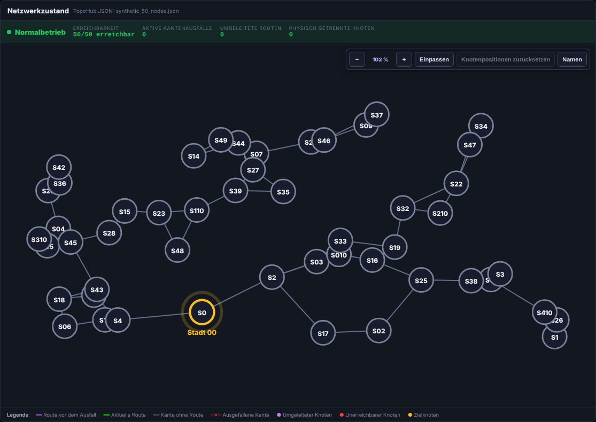
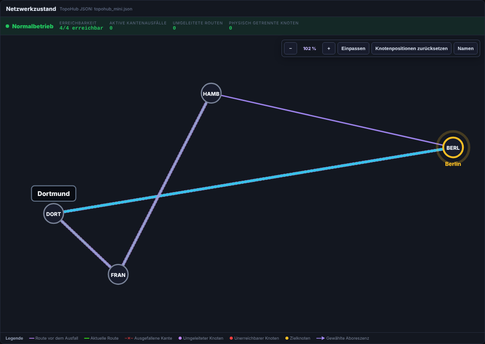
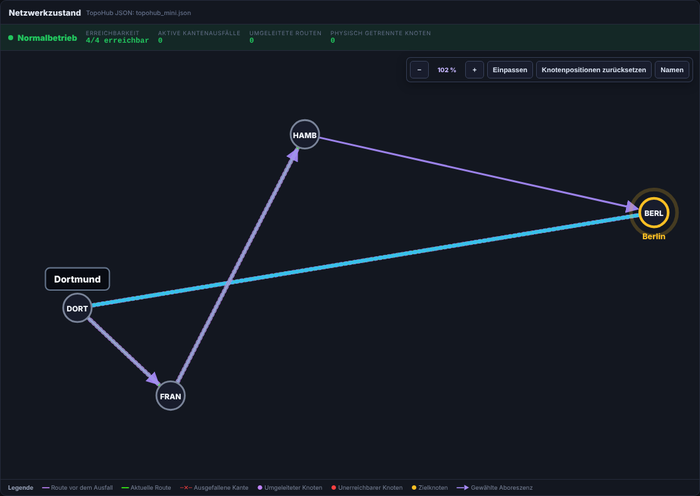
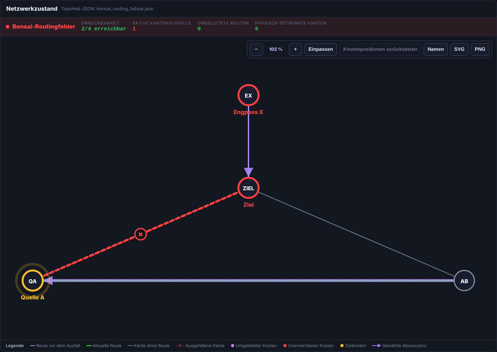

# Übersicht für Erik: Weiterentwicklung nach der Bachelorarbeit

Stand: 26. November 2026

Fünf Verbesserungen im Überblick: woher sie stammen, was sich geändert hat, wie
man sie vorführt, was geprüft ist und wo die Grenzen liegen. Layout, Begriffe,
Farbbedeutungen und Abläufe der Oberfläche sind gleich geblieben; neue
Bedienelemente gibt es nur für die beschriebenen Funktionen, im vorhandenen Stil.

## Einordnung

Die Weiterentwicklung entstand am 25. und 26. November 2026, nach der
Bachelorarbeit. Deren Referenzstände (`ed3b68c`, `99c2962`) und `main` (weiter
auf `ba4c99a`) sind unverändert; am veröffentlichten Deployment wurde nichts
geändert, und nichts wurde übernommen. Die Evaluationsergebnisse der Arbeit gehören zum damals untersuchten
Stand und belegen keine Verbesserung durch die neuen Funktionen. Keine Änderung
wurde mit Nutzenden geprüft.

## Woher kommen die fünf Punkte?

- **Rückmeldungen aus der Abschlusspräsentation:** für keinen Punkt dokumentiert.
- **Wünsche von Erik:** nur der Anwendungsfall zu Punkt 3. Der Auftrag nennt ihn
  „Eriks dokumentierter Anwendungsfall“; die Quelle liegt nicht im Repository.
- **Eigene Erweiterungswünsche:** Punkt 4 (das Tool als Windows-Programm nutzen,
  Kernfunktion ohne Internet).
- **Ohne dokumentierten Anlass:** Punkte 1, 2 und 5. Der Auftrag nennt sie ohne
  Anlass; den Export nennt er „vereinbart“, ohne zu sagen, mit wem.

„Dokumentiert“ heißt: im Repository oder im Auftrag (der Aufgabenstellung für
diese Weiterentwicklung) belegt. Mündlich kann es besprochen worden sein.
Zugeschrieben wird nur, was belegt ist.

## Die fünf Verbesserungen

Vorführen geht mit der Programmdatei aus Punkt 4 oder im Browser (`npm ci`,
`npm run dev:api`, `npm run dev`, dann `http://127.0.0.1:5173`). Testdateien
liegen in [`tests/fixtures/`](../../tests/fixtures/).

### 1. Graue Kanten besser sichtbar

- **Problem.** Kanten ohne Route waren kaum zu erkennen (Kontrast 1,14:1). Die
  Legende erklärte sie nicht.
- **Geändert.** Sie nutzen jetzt den schon vorhandenen Grauton `#64708a`, deckend
  (Kontrast 3,61:1; Richtwert 3:1 nach WCAG), und die Legende hat den Eintrag
  „Kante ohne Route“.
- **Vorführen.** `synthetic_50_nodes.json` laden, „Keine Route hervorheben“
  wählen.
- **Geprüft / Grenze.** Kontrast aus der gezeichneten Farbe berechnet, Bilder bei
  drei Topologien gesichtet. Nicht untersucht: ob Nutzende Kanten dadurch
  schneller finden. Die großen Topologien sind künstlich erzeugt.

| Vorher | Nachher |
|---|---|
|  |  |

*Gleiche Topologie (50 Knoten) vor und nach der Änderung.*

### 2. Einzelne Knoten verschieben

- **Anlass.** Die Funktion gab es schon (seit 25. November 2026 in `main`,
  [DRAGGABLE_NODES.md](../DRAGGABLE_NODES.md)); der Auftrag lautete, sie zu prüfen
  und zu stabilisieren.
- **Geändert.** Drei Mängel behoben: Knoten ließen sich aus der Graphfläche
  ziehen, Tooltips erschienen weit entfernt, Pfeilspitzen der Aboreszenz lagen
  unter dem Knotenkreis. Letzteres ist sichtbar und liegt in eigenem Commit; ob es
  übernommen wird, ist offen.
- **Vorführen.** `bonsai_routing_failure.json` laden, „Bonsai (Greedy)“ wählen,
  eine Kante ausfallen lassen, einen Knoten ziehen: Beschriftung, Kanten, Pfeile
  und Ausfallmarkierung folgen. „Knotenpositionen zurücksetzen“ stellt die
  Anordnung wieder her.
- **Geprüft / Grenze.** Automatisierte Mausabläufe in Chromium; Verschieben ändert
  die Routingergebnisse nicht. Nicht geprüft: Touch, andere Browser, Personen. Die
  Anordnung geht beim Neuladen verloren.

| Vorher | Nachher |
|---|---|
|  |  |

*Für das Verschieben selbst gibt es kein Vorher-Bild, die Funktion bestand schon.
Gezeigt wird die Korrektur der Pfeilspitzen (`topohub_mini.json`, Bonsai, ein
Knoten verschoben).*

### 3. Szenarien speichern und laden

- **Anwendungsfall.** Eine Konfiguration exportieren, weitergeben und auf einem
  anderen Rechner mit denselben Einstellungen und Ausfällen wieder öffnen. Dafür
  gab es weder Schnittstelle noch Bedienelement.
- **Geändert.** „Szenario speichern“ und „Szenario laden“. Die JSON-Datei enthält
  Topologie, Zielknoten, Verfahren, Metrik und Ausfälle; beim Laden wird sie
  geprüft und neu berechnet, bei Fehlern bleibt der bisherige Zustand unverändert.
  Optional und offen (eigener Commit): Knotenpositionen mitspeichern. Nach dem
  Speichern meldet die Seite „Download der Szenariodatei gestartet“, weil sie nur
  den Download anstoßen kann.
- **Vorführen.** `bonsai_routing_failure.json`, Bonsai, Kante ausfallen lassen,
  „Szenario speichern“, Programm neu starten, „Szenario laden“: Der Zustand ist
  wieder da.
- **Geprüft / Grenze.** Der Ablauf mit Neustart des Backends ist automatisch
  geprüft, auch für fehlerhafte Dateien. Nicht geprüft: zwei verschiedene
  Rechner. Sehr große Topologien rechnen lange (offener Befund).

*Kein Bild: Die Funktion ist neu, ein Vorher gibt es nicht. Aufnahmen stehen in
[Paket 3](PAKET_3_SZENARIEN.md).*

### 4. Windows-Programm, auch ohne Internet

- **Anlass.** Eigener Wunsch (siehe oben); bisher brauchte das Tool zwei Terminals
  oder Docker.
- **Geändert.** `FailoverRoutingVisualizer.exe` startet Backend und Oberfläche in
  einem eigenen Fenster. Der Server hört nur auf `127.0.0.1`, alle
  Oberflächendateien sind eingebaut, mit dem Fenster endet alles. Es gibt keine
  zweite Routingimplementierung.
- **Vorführen.** Programmdatei starten (SmartScreen: „Weitere Informationen“ →
  „Trotzdem ausführen“), Netzwerk trennen, Topologie laden, Szenario speichern und
  laden, SVG und PNG speichern.
- **Geprüft / Grenze.** Automatisch auf einem Windows-Runner von GitHub (Windows
  Server 2025): Start, Beenden, Import, Routing, Szenario und Bildexport
  (Downloads in der Seite abgefangen), auch bei per Firewall gesperrtem Internet.
  Nicht automatisch geprüft: Windows 10 und 11 auf einem Arbeitsplatzrechner, ein
  Rechner ganz ohne Netzwerk, der Windows-Dialog „Speichern unter“ (dazu meine
  Rückmeldung unten). Nicht signiert, kein Installationsprogramm.

*Kein Bild: Es gibt kein Vorher, und ein Bild des Programmfensters liegt nicht vor
(das Bildschirmfoto des Testlaufs wurde nicht gesichtet).*

### 5. Graph als SVG und PNG exportieren

- **Problem.** Für Bilder des Graphen blieben nur Bildschirmfotos, mit
  Bedienelementen und nur im sichtbaren Ausschnitt.
- **Geändert.** „SVG“ und „PNG“ in der Werkzeugleiste laden die gesamte Topologie
  im aktuellen Zustand herunter, unabhängig vom Zoom, mit Kopfzeile und Legende.
  Der Export kopiert die Zeichnung der Ansicht und rechnet nichts neu.
- **Vorführen.** Topologie laden, hineinzoomen, „SVG“ und „PNG“ klicken, die
  Dateien öffnen. Beispiele: [`bildexport-beispiele/`](bildexport-beispiele/).
- **Geprüft / Grenze.** Automatisch: SVG und PNG geöffnet und geprüft, die Ansicht
  bleibt unverändert, dasselbe im Windows-Fenster (Downloads in der Seite
  abgefangen). Nur Chromium und WebView2 geprüft; nur dunkle Darstellung, keine
  helle Variante für den Druck.

| Export (PNG) | Ansicht im selben Zustand |
|---|---|
|  |  |

*Kein Vorher/Nachher, der Export ist neu (`bonsai_routing_failure.json`, Kante A–T
ausgefallen). Die Werkzeugleiste vorher und nachher zeigt
[Paket 5](PAKET_5_BILDEXPORT.md#vorher--nachher).*

## Meine manuelle Rückmeldung

Von Hand auf meinem Windows-Rechner ausprobiert, nicht automatisiert:

- Start, Szenariospeicherung und Wiederherstellung nach Neustart funktionierten.
- Laden und Neuberechnung funktionierten ohne Internet.
- SVG und PNG ließen sich speichern und öffnen, auch ohne Internet.

Das sind Prüfungen der ausprobierten Abläufe, keine umfassende Abnahme und keine
Benutzerstudie. Ein Protokoll liegt nicht vor; Windows-Version, genaue
Programmdatei und die Art der Internettrennung sind nicht festgehalten. Die
automatische Prüfung des Windows-Dialogs „Speichern unter“ bleibt offen; die
Rückmeldung ersetzt sie nicht.

## Code-Stand und Nachweise

- **Code-Stand:** Zweig
  [`claude/paket-5-bildexport`](https://github.com/sammo3332/routing-simulator-hci-concept/tree/claude/paket-5-bildexport)
  mit allen fünf Punkten; Code bis Commit
  [`7cf4166`](https://github.com/sammo3332/routing-simulator-hci-concept/commit/7cf416607d83453f856b6e3ba5299f3f47f04241),
  danach nur Dokumentation. Die Punkte 1 bis 4 liegen auch einzeln auf eigenen
  Zweigen ([Übergabe, Abschnitt 1](UEBERGABE.md#1-zweige)).
- **Windows-Programm:**
  [Lauf Nr. 8](https://github.com/sammo3332/routing-simulator-hci-concept/actions/runs/45839046074)
  am Commit `7cf4166`; das Artefakt gibt es nur mit GitHub-Anmeldung, bis
  24. Februar 2027 ([Übergabe, Abschnitt 4](UEBERGABE.md#4-windows-programm)).
- **Nachweise:** [Übergabe](UEBERGABE.md) · [Prüfbericht](PRUEFBERICHT.md) ·
  Pakete [1](PAKET_1_KANTENLESBARKEIT.md) · [2](PAKET_2_KNOTENVERSCHIEBEN.md) ·
  [3](PAKET_3_SZENARIEN.md) · [4](PAKET_4_WINDOWS_APP.md) ·
  [5](PAKET_5_BILDEXPORT.md) · [Windows-Programm](../WINDOWS_APP.md).
- **Offen:** Befunde zu lokaler Absicherung der Schnittstelle, ungültigen Zahlen,
  extremen Koordinaten und großen Rechenlasten sind bewusst nicht bearbeitet und
  nicht behoben ([Prüfbericht, Abschnitt
  5](PRUEFBERICHT.md#5-unabhängige-prüfung)). Offene Entscheidungen:
  [Übergabe, Abschnitt 8](UEBERGABE.md#8-offene-entscheidungen).
