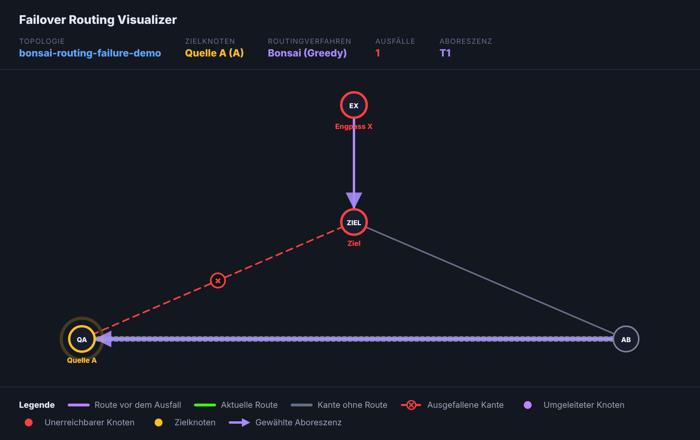

# Übersicht für Erik

Failover Routing Visualizer · Weiterentwicklung nach der Bachelorarbeit ·
Stand: 26. November 2026

Nach der Bachelorarbeit wurde der Visualizer an fünf Stellen
weiterentwickelt. Alles liegt auf dem Zweig
[`claude/paket-5-bildexport`](https://github.com/sammo3332/routing-simulator-hci-concept/tree/claude/paket-5-bildexport).
In `main` und in der Webanwendung ist davon bisher nur das Verschieben
einzelner Knoten enthalten, noch ohne die Korrekturen aus Punkt 2. Die
Referenzstände der Arbeit sind unverändert. Die Ergebnisse der Benutzerstudie
beziehen sich auf den damals untersuchten Stand; die neuen Funktionen wurden
nicht mit Nutzenden geprüft.

**Ausprobieren** lässt sich alles am einfachsten mit dem
[Windows-Testpaket](../../README.md#windows-testpaket) oder im Browser nach dem
[lokalen Start](../../README.md#lokal-im-browser). Passende Testdateien liegen
in [`tests/fixtures/`](../../tests/fixtures/).

## 1. Graue Kanten sind besser zu erkennen

In der Abschlusspräsentation kam nach meiner Erinnerung die Rückmeldung, dass
die grauen Kanten über den Beamer kaum zu sehen waren. Das betraf alle Kanten
ohne Route, bei „Keine Route hervorheben“ also die ganze Topologie. Diese
Kanten sind jetzt deckend in einem helleren, in der Oberfläche schon
vorhandenen Grau gezeichnet, und die Legende erklärt sie als „Kante ohne
Route“. Am deutlichsten wird der Unterschied mit `synthetic_50_nodes.json` und
„Keine Route hervorheben“.

| Vorher | Nachher |
|---|---|
|  |  |

## 2. Einzelne Knoten lassen sich verschieben

Auch der Wunsch, einzelne Knoten verschieben zu können, geht nach meiner
Erinnerung auf die Abschlusspräsentation zurück. Die Funktion war schon in
`main` enthalten, hatte aber drei Schwächen: Knoten ließen sich aus der
Graphfläche hinausziehen, der Tooltip eines weit verschobenen Knotens erschien
an der falschen Stelle, und die Pfeilspitzen der Aboreszenz verschwanden unter
dem Knoten. Das ist auf dem Zweig behoben. Zum Ausprobieren
`bonsai_routing_failure.json` laden, „Bonsai (Greedy)“ wählen, einen Knoten
ziehen und danach „Knotenpositionen zurücksetzen“ drücken.

## 3. Szenarien lassen sich speichern und wieder laden

Ein besprochener Anwendungsfall war, eine Konfiguration weiterzugeben und auf
einem anderen Rechner mit denselben Einstellungen und Ausfällen zu öffnen.
Bisher ging der Zustand beim Schließen verloren. Jetzt gibt es in der
Seitenleiste „Szenario speichern“ und „Szenario laden“. Die JSON-Datei enthält
Topologie, Zielknoten, Verfahren, Metrik und Ausfälle, auf Wunsch auch die
Namensanzeige und verschobene Knoten. Beim Laden rechnet das Programm alle
Ergebnisse neu aus, statt gespeicherte Ergebnisse anzuzeigen; auf dem Server
bleibt nichts gespeichert. Der Ablauf: Topologie laden, eine Kante ausfallen
lassen, speichern, Programm schließen oder Seite neu laden, dann die Datei über
„Szenario laden“ öffnen.

## 4. Ein Windows-Programm, das auch ohne Internet läuft

Das war mein eigener Ergänzungswunsch: das Werkzeug per Doppelklick starten,
ohne zwei Terminals und ohne Internetverbindung.
`FailoverRoutingVisualizer.exe` startet die vorhandene Oberfläche und den
vorhandenen Python-Kern in einem eigenen Fenster. Der lokale Server ist nur
vom eigenen Rechner aus erreichbar, und alle Dateien der Oberfläche stecken in
der Programmdatei. Das Programm ist nicht signiert; bei der SmartScreen-Warnung
führen „Weitere Informationen“ und „Trotzdem ausführen“ weiter. Danach kann man
das Netzwerk trennen und eine Topologie laden. Mehr dazu in der
[Windows-Anleitung](../WINDOWS_APP.md).

## 5. Der Graph lässt sich als PNG oder SVG exportieren

Auch ein Bildexport wurde nach meiner Erinnerung in der Abschlusspräsentation
angeregt. Bisher blieben nur Bildschirmfotos; sie zeigen lediglich den
sichtbaren Ausschnitt samt Bedienelementen. Die Schaltflächen „SVG“ und „PNG“
über dem Graphen laden jetzt ein Bild der gesamten Topologie im aktuellen
Zustand herunter, mit Kopfzeile und Legende und unabhängig vom Zoom. Das Bild
ist eine Kopie der angezeigten Zeichnung; dafür wird kein Routing neu
berechnet. Probieren lässt sich das, indem man nach dem Laden einer Topologie
stark hineinzoomt, „PNG“ klickt und die Datei öffnet. Beispielbilder liegen in
[`bildexport-beispiele/`](bildexport-beispiele/).

## Was geprüft ist und was nicht

**Automatisiert** bestanden am Code-Stand
[`7cf4166`](https://github.com/sammo3332/routing-simulator-hci-concept/commit/7cf416607d83453f856b6e3ba5299f3f47f04241)
alle Backend-, Frontend- und Browserprüfungen. Das Windows-Programm wurde im
[Lauf Nr. 8](https://github.com/sammo3332/routing-simulator-hci-concept/actions/runs/45839046074)
auf einem Windows-Server-Rechner von GitHub gebaut und im eigenen Fenster
geprüft, auch bei gesperrtem Internetzugang.

**Von Hand** habe ich auf meinem eigenen Windows-Rechner ausprobiert: Start,
Szenario speichern und nach einem Neustart wiederherstellen, Laden und
Neuberechnung ohne Internet sowie SVG und PNG speichern und öffnen, auch ohne
Internet. Das hat funktioniert. Windows-Version und genaue Programmdatei habe
ich nicht notiert; das war keine umfassende Abnahme.

**Offen** sind eine Untersuchung mit Nutzenden, eine automatisierte Prüfung des
Windows-Dialogs „Speichern unter“, Windows 10 und 11 auf einem
Arbeitsplatzrechner, andere Browser als Chromium und WebView2 sowie eine
Szenariodatei auf einem zweiten Rechner. Bekannte Schwächen bei der lokalen
Absicherung, bei ungültigen Zahlen, extremen Koordinaten und sehr großen
Topologien sind nicht behoben.

Einzelheiten: [Übergabe](UEBERGABE.md), [Prüfbericht](PRUEFBERICHT.md) und die
Paketdokumente [1](PAKET_1_KANTENLESBARKEIT.md),
[2](PAKET_2_KNOTENVERSCHIEBEN.md), [3](PAKET_3_SZENARIEN.md),
[4](PAKET_4_WINDOWS_APP.md) und [5](PAKET_5_BILDEXPORT.md).
