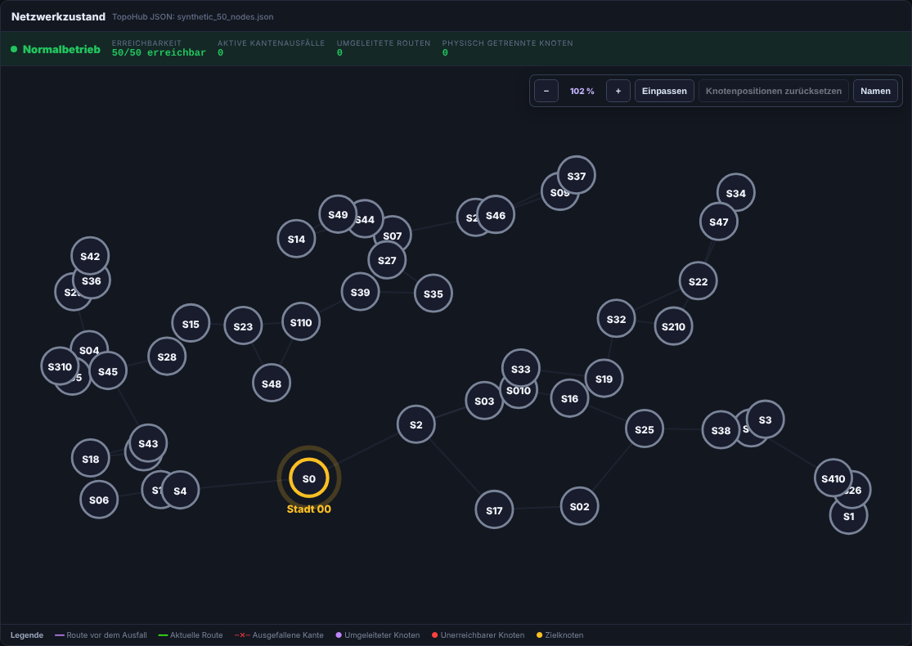

# Übersicht für Erik

Weiterentwicklung des Failover Routing Visualizers · Stand: 26. November 2026

Nach der Bachelorarbeit wurde das Tool am 25. und 26. November 2026 an fünf Stellen
weiterentwickelt. Die Oberfläche blieb wiedererkennbar; neue Bedienelemente gibt es
nur für die beschriebenen Funktionen. Die Ergebnisse der Benutzerstudie gehören zum
damals untersuchten Stand und belegen keine Verbesserung durch die neuen Funktionen;
keine Änderung wurde mit Nutzenden geprüft. Die Referenzstände der Arbeit (`ed3b68c`,
`99c2962`), der Hauptzweig `main` und das Deployment blieben unverändert.

## Die fünf Punkte

Der Anlass zu den Punkten 1, 2 und 5 ist meine Erinnerung an die Abschlusspräsentation:
meine Schilderung, kein unabhängiger Nachweis und keine persönliche Aussage von Erik.
Testdateien liegen in [`tests/fixtures/`](../../tests/fixtures/); vorgeführt wird im
Windows-Programm (Punkt 4) oder im Browser ([Start](UEBERGABE.md#7-starten)).

### 1. Sichtbarkeit der grauen Kanten

- **Anlass (meine Schilderung):** Graue Kanten waren bei der Beamer-Darstellung
  schlecht erkennbar.
- **Änderung:** Kanten ohne Route sind jetzt deckend im vorhandenen Grauton `#64708a`
  gezeichnet (Kontrast zum Hintergrund 3,61:1 statt 1,14:1), dazu gibt es einen
  Legendeneintrag.
- **Vorführen:** `synthetic_50_nodes.json` laden, „Keine Route hervorheben“ wählen.

| Vorher | Nachher |
|---|---|
|  |  |

*Gleiche Topologie. Weitere Bilder: Paketdokumente; Windows-Programm: keine.*

### 2. Einzelne Knoten verschieben

- **Anlass (meine Schilderung):** Ein Professor schlug vor, einzelne Knoten
  verschieben zu können.
- **Änderung:** Die Funktion war schon in `main`; behoben wurden drei Mängel: Knoten
  ließen sich aus der Fläche ziehen, Tooltips erschienen weit entfernt,
  Pfeilspitzen waren verdeckt.
- **Vorführen:** `bonsai_routing_failure.json` laden, einen Knoten ziehen,
  „Knotenpositionen zurücksetzen“ wählen.

### 3. Szenarien speichern und laden

- **Anlass:** ein besprochener Anwendungsfall: eine Konfiguration exportieren,
  weitergeben und auf einem anderen Rechner mit denselben Einstellungen und
  Ausfällen öffnen.
- **Änderung:** „Szenario speichern“ und „Szenario laden“ in der Seitenleiste; die
  JSON-Datei enthält Topologie, Zielknoten, Verfahren, Metrik und Ausfälle, beim
  Laden wird das Routing neu berechnet.
- **Vorführen:** `bonsai_routing_failure.json` laden, Kante ausfallen lassen,
  speichern, Programm neu starten, „Szenario laden“ wählen.

### 4. Windows-Programm, auch ohne Internet

- **Anlass:** mein eigener Ergänzungswunsch: das Tool per Doppelklick starten, ohne
  zwei Terminals, und auch ohne Internet nutzen.
- **Änderung:** `FailoverRoutingVisualizer.exe` startet Backend und Oberfläche in
  einem eigenen Fenster; der Server hört nur auf `127.0.0.1`, alle
  Oberflächendateien sind eingebaut.
- **Vorführen:** Programm starten (nicht signiert: bei SmartScreen „Weitere
  Informationen“, „Trotzdem ausführen“), Netzwerk trennen, Topologie laden.

### 5. Graph als SVG und PNG exportieren

- **Anlass (meine Schilderung):** Auch ein Bildexport wurde bei der
  Abschlusspräsentation vorgeschlagen; umgesetzt wurden PNG und SVG.
- **Änderung:** „SVG“ und „PNG“ in der Werkzeugleiste laden die gesamte Topologie
  im aktuellen Zustand herunter, unabhängig vom Zoom, mit Kopfzeile und Legende.
  Beim Bildexport wird das Routing nicht neu berechnet.
- **Vorführen:** Topologie laden, hineinzoomen, „PNG“ klicken, Datei öffnen.
  Beispiele: [`bildexport-beispiele/`](bildexport-beispiele/).

## Prüfung, Grenzen und Nachweise

Geprüft wurde technisch am Zweig
[`claude/paket-5-bildexport`](https://github.com/sammo3332/routing-simulator-hci-concept/tree/claude/paket-5-bildexport)
(alle fünf Punkte, Code bis Commit
[`7cf4166`](https://github.com/sammo3332/routing-simulator-hci-concept/commit/7cf416607d83453f856b6e3ba5299f3f47f04241)).
Das Windows-Programm stammt aus
[Lauf Nr. 8](https://github.com/sammo3332/routing-simulator-hci-concept/actions/runs/45839046074)
(Artefakt nur mit GitHub-Anmeldung, bis 24. Februar 2027); dort lief es auf einem
GitHub-Runner (Windows Server 2025), auch bei per Firewall gesperrtem Internet.
Nachweise: [Übergabe](UEBERGABE.md), [Prüfbericht](PRUEFBERICHT.md), Pakete
[1](PAKET_1_KANTENLESBARKEIT.md), [2](PAKET_2_KNOTENVERSCHIEBEN.md),
[3](PAKET_3_SZENARIEN.md), [4](PAKET_4_WINDOWS_APP.md),
[5](PAKET_5_BILDEXPORT.md).

Grenzen: Nicht untersucht ist, ob Nutzende Kanten schneller finden oder den Export
besser verstehen. Nicht automatisch geprüft sind andere Browser als Chromium und
WebView2, eine Szenariodatei auf einem zweiten Rechner, Windows 10 und 11 auf einem
Arbeitsplatzrechner, ein Rechner ganz ohne Netzwerk und der Windows-Dialog
„Speichern unter“. Befunde zu lokaler Absicherung, ungültigen Zahlen, extremen Koordinaten und
großen Rechenlasten sind nicht behoben.

## Meine manuelle Rückmeldung

Von Hand auf meinem Windows-Rechner ausprobiert:

- Start, Szenariospeicherung und Wiederherstellung nach Neustart funktionierten.
- Laden und Neuberechnung funktionierten ohne Internet.
- SVG und PNG ließen sich speichern und öffnen, auch ohne Internet.

Das sind Prüfungen der ausprobierten Abläufe, keine umfassende Abnahme und keine
Benutzerstudie; Windows-Version und Programmstand sind nicht festgehalten.
